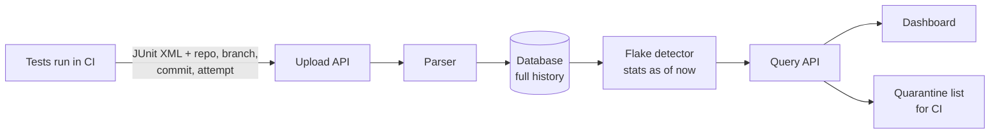
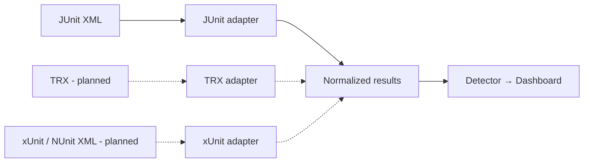
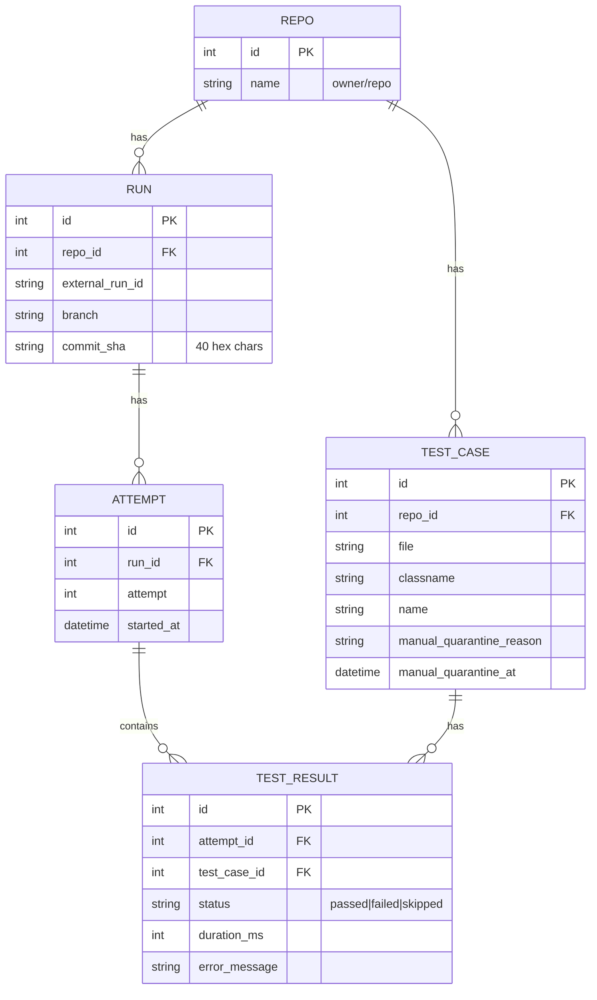

<div align="center">

# 🔍 flakewatch

**Find the tests that fail for no reason, before your team stops trusting CI.**

Detect, rank, and quarantine flaky tests from CI results. Flakewatch ingests JUnit XML, flags tests that fail then pass on the same commit, ranks them by flake rate, and shows trends in a filterable dashboard backed by a REST API.


[Why](#-why-flakewatch) ·
[How it works](#-how-it-works) ·
[Features](#-features) ·
[Quick start](#-quick-start) ·
[Flake rules](#-how-flakiness-is-measured) ·
[Synthetic data](#-synthetic-data-the-shoplite-scenario) ·
[API](#-rest-api) ·
[FAQ](#-faq)

</div>

---

> 📘 **The full behavior is defined in [`docs/SPEC.md`](docs/SPEC.md)**, which is the source of truth. This README is the overview.

## 🤔 Why flakewatch?

A **flaky test** passes and fails on the same code with no change. Timing issues, network calls, test order, and shared state are the usual causes.

This is what usually happens:

> CI goes red → someone clicks **Re-run** → it goes green → merge → move on.

The re-run erases the evidence, and the costs build up quietly:

- 🕳️ **Nothing is recorded.** Nobody knows which test failed or how often it happens.
- ⏱️ **Time and money are wasted.** Every re-run costs 10–30 minutes of waiting plus paid CI minutes.
- 📉 **Trust in CI drops.** "It's probably flaky" becomes a habit, and real bugs slip through.
- 🤷 **Nobody owns it.** CI tools show one run at a time, never a test's history across hundreds of runs.

**Flakewatch makes flakiness visible and measurable.** The goal:

> A developer opens the dashboard and, **within 30 seconds**, can name the five flakiest tests in their repo and how many failed attempts each one caused this month.

## ⚙️ How it works



1. **Tests run in CI** and write a JUnit XML report, a standard format that almost every framework can produce.
2. **CI uploads the report** with context: repo, branch, **commit SHA**, run ID, and attempt number.
3. **The parser** turns the XML into clean records and stores every result, so a history builds up.
4. **The flake detector** checks each test against one rule: *did it fail and pass on the same commit?*
5. **Stats are calculated as of the moment you ask** (flake rate, failed attempts), and each test gets a status: stable, flaky, quarantined, or broken.
6. **The dashboard** ranks the worst offenders, and **CI can fetch the quarantine list** to decide what not to block on.

> The **commit SHA** is what makes this work. It proves two runs tested identical code, so a different outcome can only mean the test is unreliable.

## ✨ Features

| | Feature | What it does |
|---|---|---|
| 📥 | **Result ingestion** | Upload a JUnit XML report through the API. Re-uploading the same attempt is **idempotent**, so it never double-counts. |
| 🎯 | **Flake detection** | Flags a test automatically when it fails and passes on the same commit, whether in a retry within one run or a separate re-run. Nobody has to report it. |
| 📊 | **Ranking** | Orders tests by flake rate or failed attempts, worst first, to answer *"what do we fix first?"* |
| 🏷️ | **Filter chips** | Filter by repo, branch, status, and the **last 7 or 30 days**. Filters live in the URL, so a view can be shared as a link. |
| 🔬 | **Test detail view** | Flake-rate trend, a pass/fail/flaky strip per commit, and recent error messages, which are often the biggest clue. |
| 🚧 | **Quarantine** | Auto-flags tests above a threshold (default **10%**, with at least 20 commits of data). Manual quarantine and release are supported, with a reason. CI fetches the full list from one endpoint. |
| 🛑 | **Broken ≠ flaky** | A test that fails *every time* from a commit onward is a real bug, so it is marked **broken** and is never quarantined or hidden. |
| ⚠️ | **Unconfirmed failures** | A failure with no passing result on the same commit isn't called flaky, but it's counted and flagged so it isn't hidden. |
| 🧹 | **Retention** | Deletes raw results after N days (default 90, minimum 37), so the database stays small and fast. |
| 🧪 | **Synthetic data generator** | Creates realistic CI history for one sample app with an **exact** number of planted flaky, stable, and broken tests, so correctness is checked against known answers. |
| 🔌 | **REST API** | The same endpoints power the dashboard, CI scripts, and any other tool. |

## 🚀 Quick start

**Prerequisites:** Node.js 20+ and npm 10+

```bash
git clone https://github.com/Build-HeliParekh/ci-flakewatch.git
cd ci-flakewatch
npm install
cp .env.example .env

npm run db:migrate    # create the SQLite schema
npm run dev           # API on :4000, dashboard on :5173
npm run seed:demo     # in a second terminal: load ShopLite data ending today
```

Open **http://localhost:5173**. You should see `auth > redirects after sso` at the top of the ranking.

> `npm run seed:demo` ends the history today, so it shows up on the real clock. `npm run seed` uses a fixed end date (2026-10-24) for the automated tests, which run with `FLAKEWATCH_NOW` set to match.

<details>
<summary><b>All npm scripts</b></summary>

| Script | What it does |
|---|---|
| `npm run dev` | Start API and dashboard in watch mode |
| `npm run build` | Build all workspaces |
| `npm test` | Unit, integration, and acceptance tests |
| `npm run test:e2e` | Playwright end-to-end tests |
| `npm run seed` | Load the ShopLite scenario with the fixed end date (for tests) |
| `npm run seed:demo` | Load the ShopLite scenario ending today (for viewing) |
| `npm run spec:check` | Check that every spec requirement has a test, and vice versa |
| `npm run bench` | Performance benchmarks |
| `npm run retention` | Run the cleanup job now |
| `npm run db:reset` | Drop and recreate the database |
| `npm run lint` | ESLint and Prettier check |

</details>

## 📐 How flakiness is measured

### The rule

> **A test is flaky on a commit when, for the same repo and commit SHA, it has at least one ❌ failed result and at least one ✅ passed result.**

The code didn't change, so the outcome shouldn't have either.

### Flake rate

> **Flake rate = flaky commits ÷ commits the test ran on** (within the selected 7- or 30-day window)

**Example:** `auth > redirects after sso` over five commits:

| Commit | Attempts | Flaky? |
|---|---|---|
| `a1` | ✅ | — |
| `b2` | ❌ ✅ | **Yes** |
| `c3` | ✅ | — |
| `d4` | ❌ ✅ | **Yes** |
| `e5` | ✅ | — |

2 flaky commits ÷ 5 commits = **40% flake rate**

**Why count commits and not runs?** If `b2` was re-run five times (❌❌❌❌✅), counting runs would make the test look far worse just because someone kept clicking re-run. Counting commits measures **reliability**: *on how many versions of the code did this test misbehave?* The wasted re-runs are tracked separately as **failed attempts**, which measures **cost**.

### Statuses

| Status | Rule | What to do |
|---|---|---|
| 🔴 `broken` | Fails on every attempt for the last 3+ consecutive commits | Fix the **code**; it's a real regression |
| 🟠 `quarantined` | Flake rate ≥ 10% **and** ≥ 20 commits run, or quarantined manually | Fix the **test**; don't let it block merges |
| 🟡 `flaky` | Flaky at least once, below the quarantine threshold | Keep an eye on it |
| 🟢 `stable` | Everything else with data | Nothing |

They are checked in that order, and the first match wins, so a broken test is never shown as merely flaky.

### Why "broken" is kept separate

| Commit | `a1` | `b2` | `c3` | `d4` | `e5` |
|---|---|---|---|---|---|
| Attempts | ✅ | ✅ | ❌ ❌ | ❌ ❌ | ❌ ❌ |

This test fails a lot, but it's **not flaky**. It fails *every time* from `c3` onward, which means someone broke something in `c3` and the test is doing its job. Treating it as flaky would quarantine a real bug and send the team hunting for timing issues instead of looking at what changed.

- **Flaky:** the test is unreliable, so fix the test.
- **Broken:** the code is broken, so fix the code.

### Edge cases

- **Unconfirmed failures:** a commit where the test only failed (never re-run, or failed again on re-run) isn't counted as flaky, because there's no pass to compare with. It's counted separately and flagged with ⚠️ in the dashboard, so it isn't hidden.
- **Skipped** results are ignored for detection and counted separately.
- **Errors** (JUnit `<error>`) count as failures.
- **Branch-only flakes:** stats are computed per branch and across all branches, so a flake that only happens on one branch is visible when filtered.
- **Renamed tests** are tracked as new tests. A test's identity is `repo + file + classname + name`.
- **Duplicate uploads** of the same `(repo, runId, attempt)` replace the earlier upload.
- **Window edges:** a window includes attempts by their start time, so a commit whose attempts straddle the start of the window is judged only on the attempts inside it.

## 🧩 Supported test frameworks

"JUnit XML" is a **file format**, not the JUnit framework. It's the de facto standard that most CI tools read, and nearly every framework can write it:

| Language | Framework | How to output JUnit XML |
|---|---|---|
| JavaScript / TypeScript | Jest, Vitest, Mocha, Playwright | `jest-junit` reporter, or built-in `--reporter=junit` |
| Python | pytest | `pytest --junitxml=report.xml` |
| Java / Kotlin | JUnit, TestNG | Built in via Maven Surefire or Gradle |
| .NET | xUnit, NUnit, MSTest | `JunitXml.TestLogger` package: `dotnet test --logger junit` |
| Go | go test | `go-junit-report` |
| Ruby | RSpec | `rspec_junit_formatter` |

The parser is built as **pluggable adapters**. Every format converts to the same internal shape, so the detector and dashboard never depend on where the data came from:



Native TRX, xUnit, NUnit, and CTRF support is on the [roadmap](#-roadmap).

## 🧪 Synthetic data: the ShopLite scenario

During development, flakewatch is fed **synthetic data**: realistic but fake CI history generated by a seeded script. No tests actually run; the generator writes the *results* a real CI would produce.

All of it describes **one fictional app**, so the data tells a single coherent story.

### Meet ShopLite

**ShopLite** (`demo/shoplite`) is a small online store with a typical test suite.

| Module | Example tests | Tests |
|---|---|---|
| `auth` | logs in with email, redirects after sso, resets password | 20 |
| `catalog` | lists products, filters by category, syncs stock | 25 |
| `search` | finds by keyword, paginates results, handles typos | 15 |
| `cart` | adds item, updates total, applies quantity limits | 20 |
| `checkout` | applies discount code, validates address, calculates tax | 25 |
| `payments` | charges card, refunds partial, retries declined payment | 15 |
| `orders` | shows order history, exports csv, cancels pending order | 15 |
| `profile` | uploads avatar, updates email, deletes account | 15 |

**History (defaults):** 60 days, 150 tests per report, and **384 commits** (8 per weekday, 2 per weekend day): 192 in the last 30 days and 44 in the last 7.

**Branches:** `main`, plus `feature/avatar-v2`, `feature/new-checkout`, and `fix/search-performance` with exactly 15% of commits each.

**Retries:** when attempt 1 has any failure, the generator adds an attempt 2 on the same commit, just as a developer clicking re-run would.

### Planted behaviors

The generator plants an **exact** number of flaky commits (for example, exactly 40% of eligible commits), so the **correct answer is known in advance** and the tests can check it exactly:

| Test | Planted behavior | flakewatch should report (30 days) |
|---|---|---|
| `checkout > applies discount code` | Always passes | 🟢 `stable`, 0% |
| `auth > redirects after sso` | Flaky on 40% of commits | 🟠 `quarantined`, **ranked #1**, 77/192 = 40.1% |
| `cart > updates total` | Flaky on 15% of commits | 🟠 `quarantined`, 29/192 = 15.1% |
| `search > paginates results` | Flaky on 5% of commits | 🟡 `flaky`, 9/192 = 4.7% |
| `payments > refunds partial` | Fails every time from 15 days before the end | 🔴 `broken`, **not** flaky |
| `profile > uploads avatar` | Flaky on 30% of `feature/avatar-v2` commits only | 🟠 `quarantined` on that branch (9/29), 🟢 `stable` on `main` |
| `orders > exports csv` | Flaky on 30% of commits, fixed 10 days before the end | 🟠 19.3% over 30 days, 0% over 7 days, falling trend |
| `catalog > syncs stock` → `catalog > syncs stock levels` | Renamed 20 days before the end | Two separate test cases |
| Everything else | Always passes | 🟢 `stable` |

```bash
npm run seed                          # fixed end date, seed 42 (for tests)
npm run seed:demo                     # same scenario, ending today (for viewing)
npm run seed -- --seed 7 --days 30    # different seed, shorter history
npm run seed -- --out ./tmp/junit     # write XML files + manifest.json only, don't upload
```

The generator writes **real JUnit XML files** and uploads them through the **real API**, so the parser and ingestion path are exercised too, not just the detector. A fixed seed gives identical files on every run, so tests never flake on their own data.

## 🔌 REST API

Base path: `/api/v1`. All responses are JSON.

| Method | Path | Description |
|---|---|---|
| `POST` | `/results` | Upload a JUnit XML report (multipart field `report`) with `repo`, `branch`, `commitSha` (full 40 characters), `runId`, `attempt`, `startedAt` |
| `GET` | `/repos` | List repos and their branches |
| `GET` | `/summary` | Counts for the overview cards. Query: `repo`, `branch`, `window` |
| `GET` | `/tests` | Ranked list. Query: `repo`, `branch`, `window` (`7d`\|`30d`, default `30d`), `status`, `q` (search), `sort` (`flakeRate`\|`failedAttempts`\|`name`), `order`, `page`, `pageSize` |
| `GET` | `/tests/:id` | Test details with stats for every window and branch |
| `GET` | `/tests/:id/history` | Results grouped by commit, plus a 30-day flake-rate trend |
| `GET` | `/quarantine?repo=` | The **complete** quarantine list for a repo, for CI |
| `POST` | `/tests/:id/quarantine` | Quarantine manually. Body: `{ "reason": "..." }` |
| `DELETE` | `/tests/:id/quarantine` | Release a manual quarantine |
| `GET` | `/health` | Liveness check |

If `UPLOAD_TOKEN` is set, every **write** (upload, quarantine, release) needs `Authorization: Bearer <token>`. Reads are open.

<details>
<summary><b>Example: upload a report</b></summary>

```bash
curl -X POST http://localhost:4000/api/v1/results \
  -F report=@junit.xml \
  -F repo=demo/shoplite \
  -F branch=main \
  -F commitSha=9f2c1ab4e7d3c0b8a6f5e4d3c2b1a0f9e8d7c6b5 \
  -F runId=123456 \
  -F attempt=1 \
  -F startedAt=2026-10-23T14:00:00Z
```

```json
{ "attemptId": 42, "tests": 150, "passed": 146, "failed": 3, "skipped": 1 }
```

</details>

<details>
<summary><b>Example: get the ranking</b></summary>

```bash
curl "http://localhost:4000/api/v1/tests?repo=demo/shoplite&window=30d&sort=flakeRate"
```

```json
{
  "asOf": "2026-10-24T00:00:00Z",
  "items": [
    {
      "id": 17,
      "name": "auth > redirects after sso",
      "file": "tests/auth.test.ts",
      "status": "quarantined",
      "quarantineSource": "auto",
      "flakeRate": 0.4010416666666667,
      "flakyCommits": 77,
      "commitsRun": 192,
      "failedAttempts": 77,
      "unconfirmedFailures": 0
    }
  ],
  "page": 1,
  "pageSize": 25,
  "total": 151
}
```

</details>

<details>
<summary><b>Example: the quarantine list for CI</b></summary>

```bash
curl "http://localhost:4000/api/v1/quarantine?repo=demo/shoplite"
```

```json
{
  "repo": "demo/shoplite",
  "asOf": "2026-10-24T00:00:00Z",
  "items": [
    { "id": 17, "file": "tests/auth.test.ts", "classname": "auth", "name": "auth > redirects after sso", "quarantineSource": "auto" }
  ]
}
```

</details>

Errors use `{ "error": { "code": "VALIDATION_ERROR", "message": "..." } }` with status codes 400, 401, 404, 409, 413, or 422.

## 🖥️ Dashboard

- **Overview cards:** broken, quarantined, and flaky tests, plus failed attempts caused by flakes, for the selected repo, branch, and window
- **Ranked table:** test name, file, flake rate, flaky commits / commits run, failed attempts, a status badge, and a ⚠️ marker for unconfirmed failures
- **Filter chips:** repo · branch · status · 7d / 30d, plus a search box
- **Test detail page:** flake-rate trend, per-commit result strip ("failed (not re-run)" where applicable), recent errors, and quarantine controls
- **Empty and error states:** no data yet, no matches, and API unreachable
- **Accessible and responsive:** keyboard-usable, WCAG 2.1 AA contrast, and works from 375 px wide

## 🏗️ Architecture and data model

| Component | Responsibility |
|---|---|
| **Upload endpoint** | Checks the token, size, metadata, and report, in that order, then stores the attempt all-or-nothing |
| **Parser adapters** | Convert each report format into normalized results |
| **Storage** | SQLite behind a repository interface, so it can be swapped for PostgreSQL later |
| **Flake detector** | Applies the rule and statuses, computing stats as of a single "now" per request |
| **Query endpoints** | Ranking, summary, history, and the quarantine list |
| **Dashboard** | React UI on top of the query API |

<details>
<summary><b>Entity relationship diagram</b></summary>



Statistics aren't stored as their own table. They're computed from these tables as of the request's "now" (caching is allowed if it gives identical results).

</details>

## 🛠️ Tech stack

| Layer | Choice |
|---|---|
| Language | TypeScript (strict) everywhere |
| Frontend | React 18, Vite, React Router, TanStack Query, Recharts |
| Backend | Node.js 20, Express, Zod, fast-xml-parser |
| Database | SQLite via better-sqlite3 |
| Testing | Vitest, Supertest, React Testing Library, Playwright, axe |
| Tooling | npm workspaces, ESLint, Prettier |

## 📁 Project structure

```text
ci-flakewatch/
├── apps/
│   ├── api/                  # Express REST API
│   │   ├── src/
│   │   │   ├── routes/       # results, tests, summary, quarantine, repos, health
│   │   │   ├── ingest/       # parser adapters (JUnit first)
│   │   │   ├── detector/     # flake rule, statuses, stats
│   │   │   ├── db/           # schema, migrations, repositories
│   │   │   ├── clock.ts      # single source of "now" (FLAKEWATCH_NOW)
│   │   │   └── server.ts
│   │   └── test/
│   └── web/                  # React dashboard
│       ├── src/
│       │   ├── pages/        # Overview, TestDetail
│       │   ├── components/   # FilterChips, RankedTable, TrendChart
│       │   └── api/          # typed API client
│       └── test/
├── packages/
│   └── shared/               # shared types: API contracts, statuses
├── tools/
│   └── seed/                 # ShopLite synthetic data generator
├── docs/
│   ├── SPEC.md               # requirements with IDs + acceptance criteria
│   ├── RETRO.md              # spec gaps and agent mistakes, for the retrospective
│   └── PRESENTATION-QA.md    # likely questions and answers for demos
├── e2e/                      # Playwright tests
├── .github/
│   └── pull_request_template.md
├── AGENTS.md                 # standing rules for AI agents and contributors
├── CLAUDE.md                 # points Claude Code to AGENTS.md
├── .env.example
├── package.json              # npm workspaces root
└── README.md
```

## 🔧 Configuration

Set these in `.env`. The defaults are shown.

| Variable | Default | Description |
|---|---|---|
| `PORT` | `4000` | API port |
| `DATABASE_PATH` | `./data/flakewatch.db` | SQLite file location |
| `QUARANTINE_THRESHOLD` | `0.10` | Flake rate that triggers quarantine |
| `QUARANTINE_MIN_COMMITS` | `20` | Minimum commits before auto-quarantine applies |
| `BROKEN_MIN_COMMITS` | `3` | Consecutive all-failing commits that mark a test broken |
| `RETENTION_DAYS` | `90` | Raw results older than this are deleted (minimum 37) |
| `MAX_UPLOAD_MB` | `10` | Maximum report size |
| `UPLOAD_TOKEN` | *(empty)* | If set, writes must send `Authorization: Bearer <token>` |
| `FLAKEWATCH_NOW` | *(empty)* | Fixes "now" to a date-time, for tests |
| `VITE_API_URL` | `http://localhost:4000` | API base URL for the dashboard |

## 📤 Uploading results from CI

Any CI system that can produce JUnit XML and run `curl` can send results. Here's an example GitHub Actions step:

```yaml
- name: Upload test results to flakewatch
  if: always()               # upload even when tests fail
  run: |
    curl -fsS -X POST "$FLAKEWATCH_URL/api/v1/results" \
      -H "Authorization: Bearer $FLAKEWATCH_TOKEN" \
      -F report=@reports/junit.xml \
      -F repo="${{ github.repository }}" \
      -F branch="${{ github.head_ref || github.ref_name }}" \
      -F commitSha="${{ github.sha }}" \
      -F runId="${{ github.run_id }}" \
      -F attempt="${{ github.run_attempt }}" \
      -F startedAt="$(date -u +%Y-%m-%dT%H:%M:%SZ)"
  env:
    FLAKEWATCH_URL: ${{ vars.FLAKEWATCH_URL }}
    FLAKEWATCH_TOKEN: ${{ secrets.FLAKEWATCH_TOKEN }}
```

`run_attempt` goes up on every re-run, which is how flakewatch sees a fail-then-pass on the same commit. `github.sha` is already the full 40-character SHA.

## ✅ Testing

Flakewatch has **its own test suite**, separate from the synthetic data:

| | Synthetic data | Flakewatch's own tests |
|---|---|---|
| **What** | Fake ShopLite CI results *fed into* flakewatch | Real tests that check *flakewatch's code* |
| **Purpose** | Gives flakewatch something to analyze | Proves it analyzes that data correctly |
| **Example** | "`cart > updates total` failed on `b2`, passed on retry" | "Given that data, the detector marks it flaky" |

| Level | Example | Tool |
|---|---|---|
| **Unit** | Fail + pass on the same commit → flaky; 2 of 5 commits → 0.40 | Vitest |
| **Integration** | POST a report, then GET `/tests` shows it; a duplicate upload doesn't double-count | Vitest + Supertest |
| **Acceptance** | After seeding ShopLite, `auth > redirects after sso` ranks #1 at exactly 77/192; `payments > refunds partial` is broken | Vitest |
| **Component** | Clicking the *Quarantined* chip shows only quarantined tests | React Testing Library |
| **End-to-end** | Seed → open dashboard → filter → open a test → see its history | Playwright |

Every requirement in [`docs/SPEC.md`](docs/SPEC.md) has an ID, and the tests that cover it reference it by name:

```ts
// SPEC: REQ-DET-01: a test is flaky on a commit if it has ≥1 failed and ≥1 passed result
it("REQ-DET-01: marks fail-then-pass on the same commit as flaky", () => { /* ... */ });
```

`npm run spec:check` fails if any requirement has no test, or a test names an ID that doesn't exist.

> 🔁 **Dogfooding:** flakewatch's own CI uploads its test results to flakewatch, so the project watches its own tests for flakiness.

## 🧭 Development workflow

1. **Spec first.** Define behavior in `docs/SPEC.md` with requirement IDs and acceptance criteria.
2. **Independent review.** A reviewer who didn't write the spec checks it for gaps and ambiguities before it's approved.
3. **Tests from the spec.** Write acceptance tests against the spec and the ShopLite scenario.
4. **Build by module.** Ingestion, detector, API, and dashboard are built against shared interfaces in `packages/shared`.
5. **Change the spec, not just the code.** For any behavior change, update the spec and its tests first, then the implementation.

## 🗺️ Roadmap

- [x] `docs/SPEC.md` v1.0 with requirement IDs and acceptance criteria
- [ ] ShopLite synthetic data generator with planted behaviors
- [ ] JUnit XML parser adapter and ingestion endpoint
- [ ] Flake detector and statuses
- [ ] Query API: ranking, summary, history, quarantine list
- [ ] Dashboard: overview, filter chips, ranked table
- [ ] Dashboard: test detail page with trend
- [ ] Retention job
- [ ] CI pipeline for this repo (lint, test, spec check, build), uploading its own results
- [ ] Quarantine hysteresis (planned change PC-01)
- [ ] Additional adapters: TRX, xUnit XML, NUnit XML, CTRF
- [ ] A real sample repo with a deliberately flaky test for a live demo
- [ ] Later: duration trend chart, per-upload new-flake counts, PostgreSQL support, Slack alerts for new quarantines, test ownership via CODEOWNERS

## ❓ FAQ

<details>
<summary><b>Does this only work with the JUnit framework?</b></summary>

No. JUnit XML is a report *format* that most frameworks can write, including Jest, pytest, xUnit, NUnit, and Go. See [Supported test frameworks](#-supported-test-frameworks). Native support for other formats such as TRX is planned through the adapter design.
</details>

<details>
<summary><b>Why count flaky commits instead of failed attempts?</b></summary>

Re-runs would distort the rate. Five re-runs of one commit shouldn't make a test look five times worse. Commits measure reliability; failed attempts measure cost. Flakewatch shows both.
</details>

<details>
<summary><b>What's the difference between flaky and broken?</b></summary>

A flaky test fails **and** passes on the same code, which means the test is unreliable. A broken test fails **every time** from some commit onward, which means the code is broken. Broken tests are never quarantined, so real bugs are never hidden.
</details>

<details>
<summary><b>Does quarantine skip the test in CI?</b></summary>

Not by itself. Flakewatch marks the test as quarantined and serves the full list at `GET /api/v1/quarantine?repo=…`. Your CI reads that list to decide whether a failure should block a merge.
</details>

<details>
<summary><b>What if a test fails once and nobody re-runs it?</b></summary>

It isn't called flaky, because there's no pass on the same commit to compare with. It stays stable but is counted as an *unconfirmed failure* and flagged with ⚠️, so it's visible.
</details>

<details>
<summary><b>Why synthetic data instead of real CI data?</b></summary>

With synthetic data, the right answer is known in advance, because the flakes are planted in exact numbers. That makes correctness provable. Real CI data is planned for the final demo, to show the tool works outside the lab.
</details>

## 🤝 Contributing

Read [`AGENTS.md`](AGENTS.md) first. It has the rules for both AI agents and people.

1. Create a branch from `main`.
2. If behavior changes, update `docs/SPEC.md` first and reference the requirement IDs in your PR.
3. Make sure `npm run lint`, `npm test`, and `npm run spec:check` pass.
4. Open a pull request describing the change and the requirements it covers.

## 📄 License

[MIT](LICENSE)
