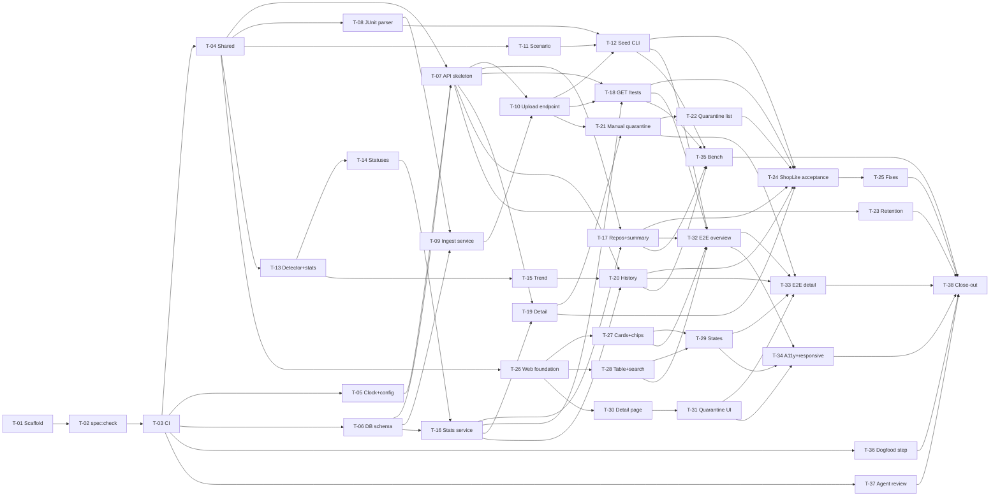

# flakewatch: Implementation Plan

| | |
|---|---|
| **Plan version** | 1.0 |
| **Based on** | `docs/SPEC.md` v1.2 |
| **Status** | Draft — awaiting human approval (PQ-01, PQ-02, PQ-21 decided) |
| **Date** | 2026-10-25 |
| **Author role** | Planner (AGENTS.md §4) |

This plan breaks SPEC v1.1 into small, reviewable tasks. It fixes the **interfaces** that tasks build against so that modules can be built in parallel, and maps **every** requirement ID to the tasks that test and implement it. It does not change behavior: where the spec is unclear, the point is listed in [§7](#7-risks-and-open-points) as a question, not decided here.

---

## Contents

1. [Header](#flakewatch-implementation-plan) (above)
2. [Overview](#2-overview)
3. [Architecture and interfaces](#3-architecture-and-interfaces)
4. [Task list](#4-task-list)
5. [Dependency graph, critical path, parallelism](#5-dependency-graph-critical-path-parallelism)
6. [Traceability matrix](#6-traceability-matrix)
7. [Risks and open points](#7-risks-and-open-points)
8. [Milestones](#8-milestones)

---

## 2. Overview

### 2.1 Phases and milestones

| Phase | Tasks | Ends at milestone |
|---|---|---|
| **P1 Foundation** | T-01 … T-07 | **M1** Pipeline green on empty scaffold (after T-01…T-04); API skeleton by T-07 |
| **P2 Core and API** | T-08 … T-25 | **M2** ShopLite ingested and ranked via API |
| **P3 Dashboard** | T-26 … T-32 | **M3** Dashboard usable |
| **P4 Hardening and close-out** | T-33 … T-38 | **M4** v1 complete |

T-36 (dogfood upload step) and T-37 (optional agent review) depend only on T-03 and can be done at any time.

### 2.2 Test-first flow per module

Most modules are split into a **pair** of stages with the same number: `T-nna` (test writer) and `T-nnb` (implementer). Because `main` is protected and the `ci` check must pass before merging, failing tests can never be merged on their own. Both stages therefore share **one branch and one pull request** (decision PQ-02):

| Step | Who | What |
|---|---|---|
| 1 | Test writer (`T-nna`) | Create branch `feat/<slug>` from `main`. Write the failing tests (named by REQ ID) and fixtures, and delete the pending placeholders ([§3.7](#37-test-conventions-fresh-db-fixed-clock-speccheck)) for the IDs now covered. Commit as `test: …`. Open a **draft** PR titled `T-nn: …`. `npm test` is expected to fail; `lint`, `build`, and `spec:check` must pass. |
| 2 | Human | Review the tests only (do they match the spec?). Approve by adding the label `tests-approved` and noting the approved commit SHA in a PR comment. Do **not** merge. |
| 3 | Implementer (`T-nnb`) | Add commits to the **same branch** until all checks pass. **Must not modify** any test file from step 1. The reviewer checks that `git diff <approved-sha>..HEAD -- '**/*.test.*' '**/*.spec.*'` is empty. Mark the PR ready for review. |
| 4 | Human | Review the implementation commits and merge. One task, one PR, one merge. |

If the implementer believes a test is wrong, it stops and says so in the PR (AGENTS.md §4, §8). The test writer fixes it on the same branch after human agreement, and the human notes the new approved SHA.

**Combined tasks (role "both").** A single agent writes tests first (first commit) then the implementation (second commit) in one PR, when the split would add overhead without adding a safety check:

| Task | Why combined |
|---|---|
| T-01 Scaffold | No requirement behavior; nothing to test-first. Role is implementer only. |
| T-02 `spec:check` | Bootstrap: CI (T-03) needs it, and every later PR depends on it. Small (~250 lines). |
| T-03, T-36, T-37 Workflows | The "implementation" is a YAML file and the test is a parser check of that file (§13.3). Both are tiny. |
| T-04 Shared contracts | Types and constants only; one table-check test. |
| T-06 DB schema | Infrastructure; covered indirectly by every integration test. Implementer only. |
| T-24, T-33 Acceptance / e2e suites | Test-writer only. If they pass, they merge directly; failures become fix tasks (T-25) or implementer stages. |
| T-32 E2E harness | Harness has no product behavior; the tests it carries are the deliverable. |
| T-38 Close-out | Verification and docs only. |

### 2.3 How this plan is updated

- **Task status** (§4.1 column *Status*: `Todo` → `Tests in review` → `In progress` → `Done`, or `Blocked`) may be changed in any normal task PR. A PR edits only **its own task's row**.
- **Scope changes** — adding, removing, or splitting tasks, moving requirement IDs between tasks, or changing any interface in §3 — need a separate `docs/plan-<topic>` PR approved by a human. Bump the plan version (1.1, 1.2, …) and note the change at the end of this file.
- An agent that needs a §3 interface to differ **stops and asks** in its PR. It doesn't change the interface on its own.
- Spec changes follow SPEC §14. If a spec change affects this plan, the plan PR follows the spec PR.

---

## 3. Architecture and interfaces

### 3.1 Workspace layout

```
/
├─ package.json              # npm workspaces root; scripts in §3.2
├─ tsconfig.base.json        # strict: true, noUncheckedIndexedAccess, exactOptionalPropertyTypes
├─ eslint.config.js          # flat config; bans `any`, `@ts-ignore`, `.only`, Date.now/new Date() outside clock.ts
├─ vitest.config.ts          # root config with test.projects; JUnit reporter → reports/junit/
├─ LICENSE (MIT)  .gitignore  .env.example
├─ docs/                     # SPEC.md, PLAN.md, RETRO.md, PRESENTATION-QA.md
├─ .github/workflows/        # ci.yml (T-03, T-36), agent-review.yml (T-37, optional)
├─ packages/shared/          # @flakewatch/shared — types, constants (no I/O)
├─ apps/api/                 # @flakewatch/api — Express + better-sqlite3
├─ apps/web/                 # @flakewatch/web — React 18 + Vite
├─ tools/seed/               # @flakewatch/seed — ShopLite generator + CLI
├─ tools/spec-check/         # @flakewatch/spec-check — traceability checker
├─ tools/bench/              # @flakewatch/bench — REQ-NFR-01 benchmarks
├─ e2e/                      # @flakewatch/e2e — Playwright
└─ test/                     # repo-level tests: test/ci/workflows.test.ts, test/spec-check/, test/traceability/pending/
```

### 3.2 npm scripts

**Root** (`package.json`), run from the repo root. Every command the spec or AGENTS.md references is here.

| Script | Command (intent) | Added by |
|---|---|---|
| `lint` | `eslint . && prettier --check .` | T-01 |
| `build` | `npm run build --workspaces --if-present` (type-check + compile; Vite build for web) | T-01 |
| `test` | `vitest run` with root `test.projects`; reporters `default` + `junit` → `reports/junit/junit.xml` (REQ-CI-03, one file — see PQ-05) | T-01 |
| `spec:check` | `npm run spec:check -w tools/spec-check` | T-02 |
| `test:e2e` | `npm run test:e2e -w e2e` | T-01 (placeholder with `--pass-with-no-tests`), T-32 removes the flag |
| `seed` | `npm run seed -w tools/seed` (defaults, `--end 2026-10-24T00:00:00Z`) | T-12 |
| `seed:demo` | `npm run seed:demo -w tools/seed` (`--end today`) | T-12 |
| `bench` | `npm run bench -w tools/bench` | T-35 |
| `retention` | `npm run retention -w apps/api` | T-23 |
| `db:migrate` | `npm run db:migrate -w apps/api` | T-06 |
| `db:reset` | `npm run db:reset -w apps/api` (deletes and re-creates `DATABASE_PATH`) | T-06 |
| `dev` | run `apps/api` `dev` and `apps/web` `dev` together (e.g. `concurrently`, see PQ-21) | T-01 (stub), T-07, T-26 |

**Per workspace**

| Workspace | Scripts |
|---|---|
| `packages/shared` | `build` (tsc -b), `test` |
| `apps/api` | `build`, `test`, `dev` (tsx watch `src/server.ts`), `start` (node dist/server.js), `db:migrate`, `db:reset`, `retention` (tsx `src/cli/retention.ts`) |
| `apps/web` | `build` (tsc + vite build), `test`, `dev` (vite), `preview` (vite preview) |
| `tools/seed` | `build`, `test`, `seed` (tsx `src/cli.ts`), `seed:demo` (tsx `src/cli.ts --end today`) |
| `tools/spec-check` | `build`, `test`, `spec:check` (tsx `src/cli.ts --spec ../../docs/SPEC.md --root ../..`) |
| `tools/bench` | `build`, `bench` (tsx `src/run.ts`) |
| `e2e` | `test:e2e` (playwright test) |

Each workspace's `test` script runs only its Vitest project (`vitest run --project <name>`); root `npm test` runs all projects once, so there is a single JUnit file.

### 3.3 `packages/shared` — exported contracts

Field names match SPEC §9 exactly. **Signatures only.**

```ts
// constants.ts
export type Status = "broken" | "quarantined" | "flaky" | "stable";
export const STATUSES: readonly Status[];                 // evaluation order (SPEC §7)
export type QuarantineSource = "auto" | "manual" | "both"; // fields are `QuarantineSource | null`
export type Window = "7d" | "30d";
export const WINDOWS: readonly Window[];
export const DEFAULT_WINDOW: Window;                      // "30d"
export const ALL_BRANCHES: "*";
export type BranchScope = string;                         // a branch name or "*"
export interface Scope { window: Window; branch: BranchScope }
export type ResultStatus = "passed" | "failed" | "skipped";
export type CommitOutcome = "passed" | "failed" | "flaky";
export type SortField = "flakeRate" | "failedAttempts" | "name";
export type SortOrder = "asc" | "desc";
export const PAGE_SIZE_DEFAULT: 25;
export const PAGE_SIZE_MAX: 100;

// errors.ts
export type ErrorCode =
  | "VALIDATION_ERROR" | "UNAUTHORIZED" | "NOT_FOUND" | "NOT_QUARANTINED"
  | "PAYLOAD_TOO_LARGE" | "INVALID_REPORT" | "INTERNAL_ERROR";
export const ERROR_HTTP_STATUS: Readonly<Record<ErrorCode, 400 | 401 | 404 | 409 | 413 | 422 | 500>>;
export interface ApiErrorBody { error: { code: ErrorCode; message: string } }

// upload.ts  (REQ-ING-01, REQ-ING-12)
export interface UploadMetadata {
  repo: string; branch: string; commitSha: string; runId: string; attempt: number; startedAt: string;
}
export interface UploadSummary { attemptId: number; tests: number; passed: number; failed: number; skipped: number }

// repos.ts  (REQ-API-02)
export interface RepoItem { name: string; branches: string[] }
export interface ReposResponse { items: RepoItem[] }

// stats.ts  (REQ-STA-02, REQ-STA-07)
export interface ScopeStats {
  commitsRun: number; flakyCommits: number; flakeRate: number; failedAttempts: number;
  unconfirmedFailures: number; skippedResults: number; lastSeenAt: string | null;
}
export interface TestIdentity { id: number; repo: string; file: string; classname: string; name: string }

// tests.ts  (REQ-API-03)
export interface TestsQuery {
  repo?: string; branch?: BranchScope; window?: Window; status?: Status[]; q?: string;
  sort?: SortField; order?: SortOrder; page?: number; pageSize?: number;
}
export interface TestListItem extends TestIdentity, ScopeStats {
  status: Status; quarantineSource: QuarantineSource | null;
}
export interface TestsResponse { items: TestListItem[]; page: number; pageSize: number; total: number; asOf: string }

// summary.ts  (REQ-API-04)
export interface SummaryQuery { repo?: string; branch?: BranchScope; window?: Window }
export interface SummaryResponse {
  asOf: string; broken: number; quarantined: number; flaky: number; stable: number; failedAttemptsFromFlakes: number;
}

// detail.ts  (REQ-API-05, REQ-QUA-01, REQ-QUA-03)
export interface ManualQuarantine { reason: string; at: string }
export interface TestScope extends ScopeStats {
  window: Window; branch: BranchScope; status: Status | null; quarantineSource: QuarantineSource | null;
}
export interface RecentError { commitSha: string; branch: string; attempt: number; startedAt: string; message: string }
export interface TestDetailResponse extends TestIdentity {
  manualQuarantine: ManualQuarantine | null; scopes: TestScope[]; recentErrors: RecentError[];
}

// history.ts  (REQ-API-06, REQ-STA-05)
export interface HistoryQuery { branch?: BranchScope; window?: Window }
export interface HistoryAttempt { attempt: number; startedAt: string; status: ResultStatus; durationMs: number } // see PQ-07
export interface HistoryCommit {
  commitSha: string; branches: string[]; firstStartedAt: string; outcome: CommitOutcome; rerun: boolean;
  attempts: HistoryAttempt[];
}
export interface TrendPoint { date: string; flakeRate: number | null } // date = "YYYY-MM-DD"
export interface HistoryResponse { commits: HistoryCommit[]; trend: TrendPoint[] }

// quarantine.ts  (REQ-QUA-01, REQ-QUA-05)
export interface QuarantineRequest { reason: string }
export interface QuarantineResponse { manualQuarantine: ManualQuarantine }
export interface QuarantineListItem {
  id: number; file: string; classname: string; name: string; quarantineSource: QuarantineSource | null;
}
export interface QuarantineListResponse { repo: string; asOf: string; items: QuarantineListItem[] }

// health.ts  (REQ-API-07)
export interface HealthResponse { status: "ok" }
```

Zod schemas live at the API edge (`apps/api/src/http/validation.ts`), built from these constants. The dashboard parses its URL state with its own small parser that uses the same constants (`WINDOWS`, `STATUSES`, …), so no value list is defined twice.

### 3.4 `apps/api` module boundaries

Rules are **pure functions** (no I/O, `now` passed in). Only `clock.ts` reads the system time.

```
apps/api/src/
  clock.ts               config.ts             logger.ts
  db/        open.ts  migrations/  repos/{ingest,read,quarantine,retention}.ts
  ingest/    junit.ts  metadata.ts  service.ts
  domain/    types.ts  windows.ts  detector.ts  stats.ts  status.ts  trend.ts  ranking.ts
  services/  stats-service.ts
  http/      app.ts  errors.ts  auth.ts  validation.ts  routes/{health,results,repos,summary,tests,history,quarantine}.ts
  cli/       retention.ts  migrate.ts  reset.ts
  server.ts  retention.ts
```

| Module | Signatures | Owns REQs | Task |
|---|---|---|---|
| `clock.ts` | `interface Clock { now(): Date }`<br>`function envClock(env?: Record<string, string \| undefined>): Clock` — reads `FLAKEWATCH_NOW` **on every call**, else system time<br>`function fixedClock(iso: string): Clock` (tests) | REQ-NFR-04 | T-05 |
| `config.ts` | `interface Config { port: number; databasePath: string; quarantineThreshold: number; quarantineMinCommits: number; brokenMinCommits: number; retentionDays: number; maxUploadMb: number; uploadToken: string \| undefined }`<br>`class ConfigError extends Error { readonly variable: string }`<br>`function loadConfig(env: Record<string, string \| undefined>): Config` — throws `ConfigError` naming the variable | REQ-RET-02, §13.2 | T-05 |
| `logger.ts` | `interface RequestLogLine { method: string; path: string; status: number; durationMs: number }`<br>`interface Logger { request(line: RequestLogLine): void; error(message: string): void }`<br>`function jsonLogger(write?: (line: string) => void): Logger` | REQ-NFR-03 | T-07 |
| `db/open.ts` | `function openDb(path: string \| ":memory:"): Database` (creates folder, `foreign_keys=ON`, WAL for files)<br>`function migrate(db: Database): void` | — | T-06 |
| `ingest/junit.ts` | `interface ParsedTestCase { position: number; file: string; classname: string; name: string; status: ResultStatus; durationMs: number; message: string \| null }`<br>`type ParseResult = { ok: true; cases: ParsedTestCase[] } \| { ok: false; message: string }`<br>`function parseJUnit(xml: string): ParseResult`<br>`function durationMsFromTime(time: string \| undefined): number`<br>`function truncateMessage(message: string, maxCodePoints?: number): string` | REQ-ING-02…06, 08 | T-08 |
| `ingest/metadata.ts` | `type MetadataResult = { ok: true; value: UploadMetadata } \| { ok: false; field: string; message: string }`<br>`function parseUploadMetadata(fields: Record<string, string \| undefined>): MetadataResult` (lower-cases `commitSha`, normalises `startedAt` to UTC) | REQ-ING-01 | T-10 |
| `ingest/service.ts` | `interface IngestOutcome { created: boolean; summary: UploadSummary }`<br>`class RunConflictError extends Error { readonly field: "commitSha" \| "branch" }`<br>`interface IngestHooks { beforeInsertResult?(index: number): void }` (test-only fault injection, REQ-ING-11)<br>`function ingestUpload(db: Database, meta: UploadMetadata, cases: readonly ParsedTestCase[], hooks?: IngestHooks): IngestOutcome` — one transaction | REQ-ING-04 (identity), 06, 07, 11, 12, 13 | T-09 |
| `http/auth.ts` | `function requireWriteToken(config: Config): RequestHandler` | REQ-ING-10 | T-10 |
| `domain/types.ts` | `interface ResultFact { testCaseId: number; repo: string; commitSha: string; branch: string; attemptId: number; attempt: number; startedAtMs: number; status: ResultStatus }`<br>`interface TimeRange { startExclusiveMs: number; endInclusiveMs: number }` | — | T-13 |
| `domain/windows.ts` | `function windowRange(window: Window, now: Date): TimeRange`<br>`function inRange(startedAtMs: number, range: TimeRange): boolean` | REQ-STA-01, DET-06 | T-13 |
| `domain/detector.ts` | `function classifyCommit(statuses: readonly ResultStatus[]): CommitOutcome \| null` (null = no decisive result)<br>`function selectScopeFacts(facts: readonly ResultFact[], branch: BranchScope, range: TimeRange): ResultFact[]`<br>`interface CommitSummary { commitSha: string; firstStartedAtMs: number; outcome: CommitOutcome; decisiveResults: number; branches: string[] }`<br>`function summarizeCommits(scopeFacts: readonly ResultFact[]): CommitSummary[]` (commits with ≥1 decisive result, oldest first; ties by `commitSha` asc) | REQ-DET-01…06 | T-13 |
| `domain/stats.ts` | `interface ScopeCounts { commitsRun: number; flakyCommits: number; flakeRate: number; failedAttempts: number; unconfirmedFailures: number; skippedResults: number }`<br>`function computeScopeCounts(scopeFacts: readonly ResultFact[]): ScopeCounts`<br>`function lastSeenAtMs(facts: readonly ResultFact[], branch: BranchScope): number \| null` (ignores the window) | REQ-STA-02, STA-07 | T-13 |
| `domain/status.ts` | `interface StatusRules { quarantineThreshold: number; quarantineMinCommits: number; brokenMinCommits: number }`<br>`function isBroken(commits: readonly CommitSummary[], brokenMinCommits: number): boolean`<br>`function meetsAutoQuarantine(counts: ScopeCounts, rules: StatusRules): boolean`<br>`function quarantineSourceOf(auto: boolean, manual: boolean): QuarantineSource \| null`<br>`function resolveStatus(input: { counts: ScopeCounts; commits: readonly CommitSummary[]; manual: boolean; rules: StatusRules }): { status: Status \| null; quarantineSource: QuarantineSource \| null }`<br>`function scopesFor(branchesWithResults: readonly string[]): Scope[]` (sorted: `7d` first, then `*`, then code point) | REQ-CLS-01…05, QUA-03, QUA-04, STA-03 | T-14 |
| `domain/trend.ts` | `function trendSeries(branchFacts: readonly ResultFact[], now: Date): TrendPoint[]` (30 points) | REQ-STA-05 | T-15 |
| `domain/ranking.ts` | `function compareTests(sort: SortField, order: SortOrder): (a: TestListItem, b: TestListItem) => number`<br>`function paginate<T>(items: readonly T[], page: number, pageSize: number): T[]` | REQ-API-03 | T-18 |
| `db/repos/read.ts` | `interface FactFilter { repo?: string; testCaseIds?: readonly number[]; branch?: BranchScope; startedAfterMs?: number; startedAtOrBeforeMs?: number }`<br>`function loadFacts(db: Database, filter: FactFilter): ResultFact[]`<br>`function loadLastSeen(db: Database, filter: { repo?: string; testCaseIds?: readonly number[] }): Map<number, Map<string, number>>`<br>`function loadBranchesWithResults(db: Database, testCaseId: number): string[]`<br>`function loadRecentErrors(db: Database, testCaseId: number, limit: number): RecentError[]` | supports STA/API | T-16 (+T-19 for errors) |
| `services/stats-service.ts` | `interface StatsService {`<br>`  listScope(p: { repo?: string; branch: BranchScope; window: Window }, now: Date): TestListItem[];`<br>`  testDetail(id: number, now: Date): TestDetailResponse \| null;`<br>`  history(id: number, scope: Scope, now: Date): HistoryResponse \| null;`<br>`  quarantineList(repo: string, now: Date): QuarantineListItem[];`<br>`  repos(): RepoItem[] }`<br>`function createStatsService(db: Database, rules: StatusRules): StatsService` | REQ-STA-06 (one `now` per call) | T-16 (methods added by T-19, T-20, T-22, T-17) |
| `db/repos/quarantine.ts` | `function getManual(db, testCaseId): ManualQuarantine \| null`<br>`function upsertManual(db, testCaseId, reason, at: Date): { created: boolean; value: ManualQuarantine }`<br>`function deleteManual(db, testCaseId): boolean`<br>`function listManualIds(db, repo?: string): number[]` | REQ-QUA-01, 02 | T-21 |
| `retention.ts` | `interface RetentionResult { attemptsDeleted: number; resultsDeleted: number; runsDeleted: number }`<br>`function runRetention(db: Database, now: Date, retentionDays: number): RetentionResult`<br>`function scheduleRetention(deps: { db: Database; clock: Clock; config: Config; logger: Logger }, intervalMs?: number): { stop(): void }` (runs at start and every 24 h) | REQ-RET-01, RET-03 | T-23 |
| `http/app.ts` | `interface AppDeps { db: Database; config: Config; clock: Clock; logger: Logger }`<br>`function createApp(deps: AppDeps): Express` — each request reads `clock.now()` **once** in a middleware and stores it on `res.locals.now`<br>`class HttpError extends Error { readonly code: ErrorCode }` | REQ-API-01, API-07, NFR-03 | T-07 |
| `server.ts` | `function startServer(env: Record<string, string \| undefined>): Promise<{ port: number; close(): Promise<void> }>` — exits non-zero on `ConfigError` | REQ-RET-02 | T-07 |

**Upload pipeline order** (REQ-ING-14), in `routes/results.ts`: `requireWriteToken` (401) → multipart parse with the size limit `MAX_UPLOAD_MB × 1,048,576` bytes on the `report` file (413) → `parseUploadMetadata` (400) → `parseJUnit` (422) → `ingestUpload` (`RunConflictError` → 400; anything else → 500).

### 3.5 Other workspace interfaces

**`tools/seed`** (no `Math.random`, no system time except in `cli.ts` for `--end today`)

```ts
export const SHOPLITE_REPO = "demo/shoplite";
export const SHOPLITE_DEFAULT_END = "2026-10-24T00:00:00Z";
export interface SeedOptions { seed: number; days: number; end: Date }          // REQ-SEED-02 defaults: 42, 60
export interface Rng { next(): number; int(min: number, max: number): number; pick<T>(items: readonly T[]): T; sample<T>(items: readonly T[], k: number): T[] }
export function createRng(seed: number): Rng;                                   // REQ-SEED-01
export interface GeneratedCase { file: string; classname: string; name: string; status: "passed" | "failed"; durationMs: number; message?: string }
export interface GeneratedAttempt { order: number; repo: string; branch: string; commitSha: string; runId: string; attempt: number; startedAt: string; cases: GeneratedCase[] }
export function generateScenario(options: SeedOptions): GeneratedAttempt[];      // REQ-SEED-03, 04, 05 (sorted in upload order)
export function toJUnitXml(attempt: GeneratedAttempt): string;                  // REQ-SEED-06
export interface ManifestEntry { file: string; repo: string; branch: string; commitSha: string; runId: string; attempt: number; startedAt: string }
export function outputFileName(attempt: GeneratedAttempt): string;              // "<NNNN>-<runId>-attempt<k>.xml"
export function buildManifest(attempts: readonly GeneratedAttempt[]): ManifestEntry[];
export function writeOut(dir: string, attempts: readonly GeneratedAttempt[]): Promise<void>;
export interface UploadReport { attemptsUploaded: number; results: number; elapsedMs: number }
export function uploadAll(attempts: readonly GeneratedAttempt[], opts: { api: string; token?: string; fetch?: typeof fetch }): Promise<UploadReport>;
export function parseCliArgs(argv: readonly string[], env: Record<string, string | undefined>, today: () => Date): { options: SeedOptions; out?: string; api: string; token?: string };
```

**`tools/spec-check`** (REQ-NFR-05)

```ts
export function extractSpecIds(markdown: string): { active: string[]; withdrawn: string[] };
export type TitleKind = "test" | "todo" | "skip";
export function extractTestTitles(source: string, fileName: string): { title: string; kind: TitleKind; line: number }[];
export interface SpecCheckResult { missing: string[]; unknown: { id: string; file: string; line: number }[]; pending: string[]; covered: Map<string, string[]> }
export function checkTraceability(specMarkdown: string, files: readonly { path: string; source: string }[]): SpecCheckResult;
export function runCli(argv: readonly string[]): Promise<number>; // exit code
```

**`tools/bench`** (REQ-NFR-01)

```ts
export function p95(samplesMs: readonly number[]): number;
export interface BenchTarget { name: string; thresholdMs: number; run(): Promise<void> }
export interface BenchReport { name: string; p95Ms: number; thresholdMs: number; overTarget: boolean }
export function runBench(targets: readonly BenchTarget[], iterations: number): Promise<BenchReport[]>;
```

**`apps/web`**

```ts
// api/client.ts
export interface ApiClient {
  repos(): Promise<ReposResponse>; tests(q: TestsQuery): Promise<TestsResponse>; summary(q: SummaryQuery): Promise<SummaryResponse>;
  test(id: number): Promise<TestDetailResponse>; history(id: number, q: HistoryQuery): Promise<HistoryResponse>;
  quarantine(id: number, body: QuarantineRequest): Promise<QuarantineResponse>; release(id: number): Promise<void>;
}
export class ApiClientError extends Error { readonly status: number | null; readonly code: ErrorCode | null } // status null = unreachable
export function createHttpClient(baseUrl: string, fetchImpl?: typeof fetch): ApiClient;  // baseUrl = VITE_API_URL
export const ApiClientContext: React.Context<ApiClient>;                                   // tests inject a fake client

// state/url-state.ts  (REQ-UI-03) — query keys = API parameter names
export interface OverviewState { repo?: string; branch: BranchScope; window: Window; status: Status[]; q?: string; sort: SortField; order: SortOrder; page: number }
export function parseOverviewState(search: URLSearchParams): OverviewState;   // invalid values fall back to defaults
export function serializeOverviewState(state: OverviewState): URLSearchParams; // omits defaults

// lib/format.ts
export function formatFlakeRate(flakyCommits: number, commitsRun: number): string; // REQ-STA-04: round(f×1000/c)/10 + "%"
export function unconfirmedLabel(count: number): string;                           // REQ-UI-04 (see PQ-18)

// components (props only)
StatusBadge({ status: Status })                                         // REQ-UI-06
OverviewCards({ summary: SummaryResponse })                             // REQ-UI-01
FilterChips({ repos: RepoItem[]; state: OverviewState; onChange(next: OverviewState): void }) // REQ-UI-02
RankedTable({ data: TestsResponse; state: OverviewState; onSort(field: SortField): void; onPage(page: number): void; onOpen(id: number): void }) // REQ-UI-04
SearchBox({ value: string; onSearch(q: string | undefined): void; debounceMs?: number })  // REQ-UI-05 (300)
StatePanel({ kind: "loading" | "empty" | "no-match" | "error"; onRetry?(): void; onClear?(): void })     // REQ-UI-08
TrendChart({ points: TrendPoint[] }); CommitStrip({ commits: HistoryCommit[] }); QuarantineControls({ detail: TestDetailResponse }) // REQ-UI-07

// routes: "/" (OverviewPage), "/tests/:id" (DetailPage; carries the overview query string for the back link)
```

**`e2e`**: Playwright config with two `webServer` entries — the API on port 4100 with a temporary `DATABASE_PATH`, `FLAKEWATCH_NOW=2026-10-24T00:00:00Z`, `UPLOAD_TOKEN` set; the web app via `vite preview` on 4173 built with `VITE_API_URL=http://localhost:4100`. A global setup seeds ShopLite with defaults through `tools/seed` upload mode.

### 3.6 Database schema (SQLite, `better-sqlite3`)

Times are stored as UTC epoch milliseconds (`*_ms INTEGER`) for range comparisons; the API serialises them as ISO 8601 UTC (format: PQ-06). Migrations are numbered SQL files in `apps/api/src/db/migrations/`, applied by `migrate()` at startup and by `npm run db:migrate`.

| Table | Columns | Keys and indexes | Spec term |
|---|---|---|---|
| `schema_migrations` | `version INTEGER`, `applied_at_ms INTEGER` | PK `version` | — |
| `runs` | `id INTEGER`, `repo TEXT`, `run_id TEXT`, `commit_sha TEXT` (40 lower-case hex), `branch TEXT` | PK `id`; UNIQUE (`repo`, `run_id`); INDEX (`repo`, `commit_sha`) | Run, Commit, Branch |
| `attempts` | `id INTEGER` (= `attemptId`), `run_pk INTEGER` → `runs.id` ON DELETE CASCADE, `attempt INTEGER` (≥ 1), `started_at_ms INTEGER` | PK `id`; UNIQUE (`run_pk`, `attempt`); INDEX (`started_at_ms`) | Attempt, Upload |
| `test_cases` | `id INTEGER` (the API `id`), `repo TEXT`, `file TEXT`, `classname TEXT`, `name TEXT` | PK `id`; UNIQUE (`repo`, `file`, `classname`, `name`); INDEX (`repo`, `name`) | Test case |
| `results` | `id INTEGER`, `attempt_pk INTEGER` → `attempts.id` ON DELETE CASCADE, `test_case_id INTEGER` → `test_cases.id`, `position INTEGER` (1-based order in report), `status TEXT` CHECK IN (`passed`,`failed`,`skipped`), `duration_ms INTEGER`, `message TEXT NULL` | PK `id`; INDEX (`test_case_id`, `attempt_pk`); INDEX (`attempt_pk`) | Result |
| `manual_quarantines` | `test_case_id INTEGER` → `test_cases.id`, `reason TEXT`, `at_ms INTEGER` | PK `test_case_id` | Manual quarantine |

Retention (REQ-RET-01) deletes `attempts` (cascading to `results`) and then `runs` with no attempts; it never touches `test_cases` or `manual_quarantines`. Re-upload (REQ-ING-07) deletes the attempt's `results` and rewrites its metadata in the same transaction.

### 3.7 Test conventions, fresh DB, fixed clock, spec:check

**Folders and names**

| Kind | Location | Runner |
|---|---|---|
| Unit (pure functions) | `<workspace>/test/unit/**/*.test.ts` | Vitest |
| Integration (DB, HTTP via Supertest) | `apps/api/test/integration/**/*.test.ts` | Vitest |
| ShopLite acceptance (API) | `apps/api/test/acceptance/shoplite.test.ts` | Vitest |
| Component (React Testing Library, jsdom) | `apps/web/test/**/*.test.tsx` | Vitest |
| Workflow checks | `test/ci/workflows.test.ts` (path fixed by SPEC §13.3) | Vitest |
| spec:check's own tests | `test/spec-check/*.test.ts` | Vitest |
| End-to-end | `e2e/tests/*.spec.ts` | Playwright |
| Benchmarks | `tools/bench/src/*.bench.ts` (registered with `bench("REQ-NFR-01: …")`) | `npm run bench` |
| Pending placeholders | `test/traceability/pending/REQ-<AREA>-<NN>.test.ts` (one file per ID) | Vitest (`it.todo`) |

**Test titles.** The `it`/`test`/`bench` title is a **string literal** that starts with one or more IDs, comma-separated, then a colon: `it("REQ-DET-01, REQ-DET-02: ignores skipped results when judging a commit", …)`. Titles built from variables or templates aren't seen by `spec:check`. `describe` names may mention IDs but don't count.

**Fresh database.** `apps/api/test/helpers/` (created in T-06, extended by later tasks):

```ts
export function createTestDb(): Database;                       // openDb(":memory:") + migrate
export function tmpDbPath(): string;                            // file DB under os.tmpdir() for CLI/startup tests
export function insertFacts(db: Database, rows: readonly FactRow[]): void; // direct inserts for stats tests (no ingest dependency)
export function createTestApp(opts?: { env?: Record<string, string>; now?: string }): {
  app: Express; db: Database; env: Record<string, string | undefined>; logs: string[];
};                                                              // in-memory DB; envClock(env) so tests can change FLAKEWATCH_NOW between requests
export function junit(cases: readonly TestCaseFixture[], opts?: { root?: "testsuites" | "testsuite" }): string; // XML fixture builder
```

Every integration test gets its own DB. ShopLite acceptance seeds once per test file (`beforeAll`): `generateScenario` with defaults → upload every attempt through `POST /api/v1/results` via Supertest → `FLAKEWATCH_NOW=2026-10-24T00:00:00Z`.

**Fixed clock.** Pure functions take `now: Date`. HTTP tests use `createTestApp({ now })`, which puts `FLAKEWATCH_NOW` into the env object read by `envClock`. No test reads the real clock. Seeded randomness only (`createRng(seed)`).

**spec:check.** Reads `docs/SPEC.md`, collects active IDs from `#### REQ-<AREA>-<NN>` headings (a requirement is excluded when its heading contains **Withdrawn**, or its first body line *starts* with it; a body that only mentions the word, like REQ-NFR-05's, doesn't count). It parses every `**/*.{test,spec,bench}.{ts,tsx}` file outside `node_modules`/`dist` with the TypeScript compiler API and reads the titles of `it`/`test`/`bench` calls, including `.each`, `.concurrent`, `.skip`, and `.todo`. Then:

- **missing** = active IDs not at the start of any `test`- or `todo`-kind title → error
- **unknown** = any `REQ-…` ID anywhere in a title that is not in the spec → error, naming the ID and file
- **pending** = IDs covered **only** by `todo` titles → printed as a count and list, not an error (SPEC REQ-NFR-05, decision D-14)
- `skip`-kind titles don't count as coverage
- Exit code `1` if there are missing or unknown IDs, else `0`. With `--strict`, any pending ID is also an error (exit `1`).

T-02 creates one pending placeholder per active ID (except REQ-NFR-05, which T-02 covers for real). Each test-writer task deletes the placeholder files for the IDs it now covers. M4 requires zero pending.

**Lint rules that protect the conventions:** no `.only`; no `Date.now()`/`new Date()` with no arguments outside `apps/api/src/clock.ts` and `tools/seed/src/cli.ts`; no `Math.random` in `tools/seed`.

---

## 4. Task list

Legend. **Role:** TW = test writer, IM = implementer, Both = combined (see §2.2). **Size:** S ≈ < 150 changed lines, M ≈ 150–400, L > 400 (should be split). Line counts exclude fixtures and generated files. "All later tasks" implicitly depend on **T-03** so CI checks every PR.

### 4.1 Summary table

| ID | Title | Branch(es) | Role | Depends on | REQs | Size | Status |
|---|---|---|---|---|---|---|---|
| T-01 | Scaffold | `chore/scaffold` | IM | — | None | M | Done |
| T-02 | spec:check + pending registry | `chore/spec-check` | Both | T-01 | NFR-05 | S | Done |
| T-03 | CI workflow `ci.yml` | `ci/pr-checks` | Both | T-02 | CI-01, 02, 03, 05 | S | Done |
| T-04 | Shared contracts | `feat/shared-contracts` | Both | T-03 | API-01 | S | Done |
| T-05 | Clock and config | `feat/clock-config` | TW → IM | T-03 | NFR-04, RET-02 | S | Todo |
| T-06 | Database schema and test helpers | `chore/db-schema` | IM | T-03 | None | M | Todo |
| T-07 | API skeleton: app, errors, logging, health, startup | `feat/api-skeleton` | TW → IM | T-04, T-05, T-06 | API-01, API-07, NFR-03, RET-02 | M | Todo |
| T-08 | JUnit parser | `feat/junit-parser` | TW → IM | T-04 | ING-02…06, ING-08 | M | Todo |
| T-09 | Ingest service (storage) | `feat/ingest-service` | TW → IM | T-06, T-08 | ING-04…07, ING-11…13 | M | Todo |
| T-10 | Upload endpoint `POST /results` | `feat/upload-endpoint` | TW → IM | T-07, T-09 | ING-01…03, 07…14 | M | Todo |
| T-11 | ShopLite scenario generator | `feat/seed-scenario` | TW → IM | T-04 | SEED-03, 04, 05 | M/L | Todo |
| T-12 | Seed output, manifest, CLI | `feat/seed-cli` | TW → IM | T-08, T-10, T-11 | SEED-01, 02, 06 | M | Todo |
| T-13 | Detector and window statistics | `feat/detector` | TW → IM | T-04 | DET-01…06, STA-01, 02, 07 | M | Done |
| T-14 | Statuses, scopes, quarantine rules | `feat/statuses` | TW → IM | T-13 | CLS-01…05, QUA-03, 04, STA-03 | M | Done |
| T-15 | Trend series | `feat/trend` | TW → IM | T-13 | STA-05 | S | Todo |
| T-16 | Stats read service | `feat/stats-service` | TW → IM | T-06, T-14 | STA-03, STA-06 | M | Todo |
| T-17 | `GET /repos`, `GET /summary` | `feat/repos-summary` | TW → IM | T-07, T-16 | API-02, API-04 | M | Todo |
| T-18 | `GET /tests` ranked list | `feat/tests-list` | TW → IM | T-07, T-10, T-16 | API-01, 03, CLS-05, STA-06, NFR-04, ING-10, ING-11 | M | Todo |
| T-19 | `GET /tests/:id` detail | `feat/test-detail` | TW → IM | T-07, T-16 | API-01, API-05, STA-03, QUA-03 | M | Todo |
| T-20 | `GET /tests/:id/history` | `feat/test-history` | TW → IM | T-07, T-15, T-16 | API-06, STA-05 | M | Todo |
| T-21 | Manual quarantine `POST`/`DELETE` | `feat/manual-quarantine` | TW → IM | T-10, T-19 | QUA-01, QUA-02, ING-10 | M | Todo |
| T-22 | `GET /quarantine` list for CI | `feat/quarantine-list` | TW → IM | T-21 | QUA-05 | S | Todo |
| T-23 | Retention cleanup | `feat/retention` | TW → IM | T-07 | RET-01, RET-03 | S | Todo |
| T-24 | ShopLite acceptance suite (API) | `test/shoplite-acceptance` | TW | T-12, T-17…T-22 | SEED-03, 05, DET-05, STA-05, QUA-05, API-02…05 | M | Todo |
| T-25 | ShopLite discrepancy fixes (conditional) | `fix/shoplite-acceptance` | IM | T-24 | as failing | S–M | Todo |
| T-26 | Web foundation | `feat/web-foundation` | TW → IM | T-04 | STA-04, UI-03, UI-06 | M | Todo |
| T-27 | Overview cards and filter chips | `feat/overview-filters` | TW → IM | T-26 | UI-01, UI-02 | M | Todo |
| T-28 | Ranked table and search | `feat/ranked-table` | TW → IM | T-26 | UI-04, UI-05 | M | Todo |
| T-29 | Loading, empty, error states | `feat/ui-states` | TW → IM | T-27, T-28 | UI-08 | S | Todo |
| T-30 | Test detail page (read-only) | `feat/detail-page` | TW → IM | T-26 | UI-07 | M | Todo |
| T-31 | Quarantine controls | `feat/quarantine-controls` | TW → IM | T-30 | UI-07, UI-09 | S | Todo |
| T-32 | E2E harness and overview flows | `test/e2e-overview` | Both | T-12, T-17, T-18, T-27, T-28 | NFR-02, UI-01…05 | M | Todo |
| T-33 | E2E detail, quarantine, error flows | `test/e2e-detail` | TW (+ fix) | T-20, T-21, T-29, T-31, T-32 | UI-07, UI-08 | S | Todo |
| T-34 | Accessibility and responsive layout | `feat/a11y` | TW → IM | T-29, T-31, T-32 | UI-09, UI-10 | M | Todo |
| T-35 | Benchmarks | `feat/bench` | TW → IM | T-12, T-17, T-18, T-20 | NFR-01 | M | Todo |
| T-36 | Dogfood upload step | `ci/dogfood-upload` | Both | T-03 | CI-04 | S | Todo |
| T-37 | Agent review workflow (optional) | `ci/agent-review` | Both | T-03 | CI-06 | S | Todo |
| T-38 | Traceability close-out and docs | `docs/v1-closeout` | IM | all others | NFR-05 (verify) | S | Todo |

### 4.2 Task details

Each entry adds: parallelism, files it may touch, scope, and done notes. All tasks also follow the definition of done in AGENTS.md §10 and may update their own row in §4.1, `docs/RETRO.md`, and (when commands or user-visible behavior change) `README.md`.

#### Phase 1 — Foundation

**T-01 Scaffold** · `chore/scaffold` · IM · depends: — · parallel: none (first task) · REQs: None · M
- *Files:* root `package.json`, `package-lock.json`, `tsconfig.base.json`, `eslint.config.js`, `.prettierrc`, `vitest.config.ts`, `LICENSE`, `.gitignore`, `.env.example`, `packages/shared/{package.json,tsconfig.json,src/index.ts}`, `apps/api/{package.json,tsconfig.json,src/index.ts}`, `apps/web/{package.json,tsconfig.json,vite.config.ts,index.html,src/main.tsx}`, `tools/seed/…`, `tools/spec-check/…`, `tools/bench/…`, `e2e/{package.json,playwright.config.ts}`, `test/` (empty project).
- *Scope:* npm workspaces for all packages in §3.1; TypeScript strict; ESLint + Prettier with the §3.7 rules; Vitest root `test.projects` with JUnit reporter → `reports/junit/junit.xml` and `passWithNoTests`; `test:e2e` placeholder (`playwright test --pass-with-no-tests`); MIT `LICENSE`; `.gitignore` (`node_modules`, `dist`, `data/`, `*.db`, `reports/`, `.env`, `playwright-report/`, `test-results/`); `.env.example` listing every §13.2 variable with its default and a comment.
- *Done:* `npm ci && npm run lint && npm run build && npm test && npm run test:e2e` all succeed locally on an empty project. No feature code. Dependency list matches PQ-21 approval.

**T-02 spec:check + pending registry** · `chore/spec-check` · Both · depends: T-01 · parallel: — · REQs: REQ-NFR-05 · S
- *Files:* `tools/spec-check/src/**`, `test/spec-check/**`, `test/traceability/pending/*.test.ts`, root `package.json` (script).
- *Scope:* implement §3.5 `tools/spec-check` per §3.7. Tests use fixture strings, e.g. a test named `REQ-DET-99: …` → fails and names `REQ-DET-99`; a missing ID → fails; todo-only → pending, exit 0, but `--strict` fails and names it; `.skip` doesn't count; Withdrawn is ignored. Generate one `it.todo("REQ-XXX-NN: pending")` file for each of the other 73 active IDs.
- *Done:* `npm run spec:check` exits 0 on the repo and prints "73 pending"; `npm run spec:check -- --strict` exits non-zero; the fixture tests prove both mismatch kinds exit non-zero.

**T-03 CI workflow** · `ci/pr-checks` · Both · depends: T-02 · parallel: — · REQs: REQ-CI-01, REQ-CI-02, REQ-CI-03, REQ-CI-05 · S
- *Files:* `.github/workflows/ci.yml`, `test/ci/workflows.test.ts`, root `package.json` (`yaml` devDependency).
- *Scope:* `ci.yml` named `ci`, on `pull_request` (branches `main`) and `push` (branches `main`); `ubuntu-latest`, Node 22, `actions/setup-node` with `cache: npm`; steps in order `npm ci` → `npm run lint` → `npm run build` → `npm test` → `npm run spec:check` → `npm run test:e2e`; a Playwright browser cache step (`~/.cache/ms-playwright`, keyed on the lockfile) plus `npx playwright install --with-deps chromium` before e2e; `actions/upload-artifact` for `reports/junit/` named `test-results`, `retention-days: 30`, `if: always()`; no `secrets.` reference. Tests parse the YAML and assert each acceptance criterion.
- *Done:* tests green; CI runs on this PR itself and is green. The *(manual)* criteria of REQ-CI-01 and REQ-CI-03 are checked by a human (push a deliberately failing test on a throwaway branch) and noted in the PR. Admin applies the branch protection from SPEC §13.3.

**T-04 Shared contracts** · `feat/shared-contracts` · Both · depends: T-03 · parallel: T-05, T-06, T-11, T-13 (after merge) · REQs: REQ-API-01 · S
- *Files:* `packages/shared/src/**`, `packages/shared/test/**`.
- *Scope:* exactly the exports in §3.3. One test `REQ-API-01: maps every error code to its HTTP status` checks `ERROR_HTTP_STATUS` against the SPEC §9 table.
- *Done:* `npm run build` compiles; API and web can import `@flakewatch/shared`.

**T-05 Clock and config** · TW `test/clock-config` → IM `feat/clock-config` · depends: T-03 · parallel: T-04, T-06, T-08, T-11, T-13 · REQs: REQ-NFR-04, REQ-RET-02 · S
- *Files:* `apps/api/src/{clock,config}.ts`, `apps/api/test/unit/{clock,config}.test.ts`.
- *Scope:* `envClock` returns `FLAKEWATCH_NOW` when set to an ISO date-time, system time otherwise, re-reading on every call (REQ-NFR-04). `loadConfig` validates every §13.2 variable with Zod and throws `ConfigError` naming it; `RETENTION_DAYS = 30` → error naming `RETENTION_DAYS` (REQ-RET-02). Other §13.2 validation tests are written without REQ IDs (PQ-11).
- *Done:* unit tests green; no other module reads `process.env` for these values.

**T-06 Database schema and test helpers** · `chore/db-schema` · IM · depends: T-03 · parallel: T-04, T-05, T-08, T-11, T-13 · REQs: None · M
- *Files:* `apps/api/src/db/{open.ts,migrations/**}`, `apps/api/src/cli/{migrate,reset}.ts`, `apps/api/test/helpers/{db,facts}.ts`, `apps/api/test/integration/db.test.ts`, `apps/api/package.json` (scripts).
- *Scope:* §3.6 schema; `openDb`, `migrate`; `db:migrate`, `db:reset`; `createTestDb`, `tmpDbPath`, `insertFacts`. Smoke tests (no REQ IDs): migrations are idempotent, cascades delete results, the unique keys hold.
- *Done:* schema matches §3.6; helpers documented in the file header.

**T-07 API skeleton** · TW `test/api-skeleton` → IM `feat/api-skeleton` · depends: T-04, T-05, T-06 · parallel: T-08, T-09, T-11, T-13…T-15, T-26 · REQs: REQ-API-01, REQ-API-07, REQ-NFR-03, REQ-RET-02 · M
- *Files:* `apps/api/src/{logger,server}.ts`, `apps/api/src/http/{app,errors,validation}.ts`, `apps/api/src/http/routes/health.ts`, `apps/api/test/helpers/app.ts`, `apps/api/test/integration/{errors,health,logging,startup}.test.ts`.
- *Scope:* `createApp` with JSON responses, one `now` per request (`res.locals.now`), unknown route → `404 NOT_FOUND` in the error format, unexpected error → `500 INTERNAL_ERROR` without stack trace; `jsonLogger` writes one JSON line per request with method, path (no query string), status, duration, and never headers or bodies; `GET /api/v1/health` → `200 {status:"ok"}`, `503` when the DB check fails; `startServer` exits non-zero with the variable name when `loadConfig` throws (REQ-RET-02 "when the server starts"). `createTestApp` helper.
- *Done:* REQ-NFR-03 test uses an upload-shaped request with `Authorization: Bearer secret` against any route and asserts the log line has path and status but not `secret` (the real upload route is re-checked in T-10).

#### Phase 2 — Core and API

**T-08 JUnit parser** · TW `test/junit-parser` → IM `feat/junit-parser` · depends: T-04 · parallel: T-05…T-07, T-11, T-13 · REQs: REQ-ING-02, 03, 04, 05, 06, 08 · M
- *Files:* `apps/api/src/ingest/junit.ts`, `apps/api/test/unit/junit.test.ts`, `apps/api/test/fixtures/junit/**`.
- *Scope:* `parseJUnit` with fast-xml-parser: status mapping incl. skipped+failure → failed; `<testsuites>` and single `<testsuite>` roots; nested suites; file/classname fallbacks; missing/empty `name` → error naming the 1-based position; duration rounding (`2.3456` → 2346, `0.0005` → 1, invalid → 0); message from attribute or text, truncated to 2,000 code points; repeated cases kept; malformed XML / wrong root / zero cases → error.
- *Done:* every SPEC §4 parse-level acceptance criterion has a unit test.

**T-09 Ingest service** · TW `test/ingest-service` → IM `feat/ingest-service` · depends: T-06, T-08 · parallel: T-07, T-11, T-13…T-16 · REQs: REQ-ING-04, 05, 06, 07, 11, 12, 13 · M
- *Files:* `apps/api/src/ingest/service.ts`, `apps/api/src/db/repos/ingest.ts`, `apps/api/test/integration/ingest-service.test.ts`.
- *Scope:* `ingestUpload` in one transaction: upsert run (reject differing `commitSha`/`branch` with `RunConflictError`), upsert test cases by identity, replace an existing attempt's metadata and results (`created: false`), store each repeated case as its own result, store duration and message, return the summary counts. `hooks.beforeInsertResult` throwing at index 1 → nothing stored.
- *Done:* tests cover the storage-level criteria (150 → 150 not 300; same identity → same test case; summary 146/3/1).

**T-10 Upload endpoint** · TW `test/upload-endpoint` → IM `feat/upload-endpoint` · depends: T-07, T-09 · parallel: T-11, T-13…T-17, T-19 · REQs: REQ-ING-01, 02, 03, 07, 08, 09, 10, 11, 12, 13, 14 · M
- *Files:* `apps/api/src/ingest/metadata.ts`, `apps/api/src/http/{auth,routes/results}.ts`, `apps/api/test/integration/upload.test.ts`, `apps/api/package.json` (multipart dependency, PQ-21).
- *Scope:* §3.4 upload pipeline; `requireWriteToken`; size limit using `MAX_UPLOAD_MB`; metadata errors name the field; `201` new / `200` replaced; `422` for parse errors with DB unchanged; `500` on store failure; check order 401 → 413 → 400 → 422. HTTP-level checks of ING-02 (stored statuses) and ING-03 (two empty DBs give identical stored results). Re-asserts REQ-NFR-03 on the real upload route.
- *Done:* every SPEC §4 HTTP acceptance criterion has a test, except "GET /tests reflects the upload" (T-18).

**T-11 ShopLite scenario generator** · TW `test/seed-scenario` → IM `feat/seed-scenario` · depends: T-04 · parallel: T-05…T-10, T-13…T-16, T-26 · REQs: REQ-SEED-03, 04, 05 · M/L
- *Files:* `tools/seed/src/{rng,calendar,catalog,planting,scenario}.ts`, `tools/seed/test/unit/**`.
- *Scope:* `createRng`, `generateScenario`: 150-case catalogue across 8 modules with the planted names in SPEC §12; day calendar (8 weekday / 2 weekend commits, 08:00–20:00 UTC), segments S1/S2/S3, exact branch counts per segment, attempt 2 rules, durations, realistic messages, exact-count planting per segment for each SEED-05 row, the `catalog > syncs stock` rename from day −20. Tests assert generator-level facts: 384 commits, 44/192 in windows, `feature/avatar-v2` 7/22/29, planted counts (e.g. p = 0.40 with 44 eligible → 18), payments fails every attempt from day −15.
- *Done:* tests green. **Split guidance:** if the diff exceeds ~400 lines, split into T-11a1 (calendar, branches, attempts — SEED-03) and T-11a2 (planting — SEED-04/05) via a plan PR.

**T-12 Seed output, manifest, CLI** · TW `test/seed-cli` → IM `feat/seed-cli` · depends: T-08, T-10, T-11 · parallel: T-13…T-23, T-26…T-31 · REQs: REQ-SEED-01, 02, 06 · M
- *Files:* `tools/seed/src/{junit-writer,manifest,output,upload,cli}.ts`, `tools/seed/test/**`, `tools/seed/package.json` (scripts), root `package.json` (`seed`, `seed:demo`).
- *Scope:* `toJUnitXml` in `<testsuites>` form with correct suite counts; `--out` mode files + `manifest.json` in upload order; upload mode with summary (attempts, results, elapsed); `--token` defaulting to `UPLOAD_TOKEN`; `--end today`. Tests: two `--out` runs with seed 42 give identical checksums; every generated file passes `parseJUnit` and counts match; upload mode against an in-process `createApp` with `UPLOAD_TOKEN=abc` succeeds (injected `fetch`, no external network).
- *Done:* `npm run seed` against `npm run dev` loads ShopLite.

**T-13 Detector and window statistics** · TW `test/detector` → IM `feat/detector` · depends: T-04 · parallel: T-05…T-12, T-26 · REQs: REQ-DET-01…06, REQ-STA-01, 02, 07 · M
- *Files:* `apps/api/src/domain/{types,windows,detector,stats}.ts`, `apps/api/test/unit/{windows,detector,stats}.test.ts`.
- *Scope:* pure functions in §3.4. Covers every DET and STA-01/02/07 acceptance criterion with in-memory `ResultFact` arrays, including the window boundary (`2026-10-17T00:00:00Z` excluded, `…:01Z` included), the straddling commit, `*` merging the same SHA across branches, and a rename giving two separate test cases (DET-05).
- *Done:* 100 % of these criteria as unit tests; no I/O imports.

**T-14 Statuses, scopes, quarantine rules** · TW `test/statuses` → IM `feat/statuses` · depends: T-13 · parallel: T-15, T-16 (after), T-08…T-12 · REQs: REQ-CLS-01…05, REQ-QUA-03, REQ-QUA-04, REQ-STA-03 · M
- *Files:* `apps/api/src/domain/status.ts`, `apps/api/test/unit/status.test.ts`.
- *Scope:* `isBroken` with ordering by earliest in-scope `startedAt` then `commitSha`; inclusive threshold; minimum commits; manual applies to every scope; precedence broken → quarantined → flaky → stable; `null` for `commitsRun = 0`; `quarantineSourceOf` truth table; auto release without hysteresis; `scopesFor` produces `{7d,30d} × {branches…, *}` in API-05 order.
- *Done:* all SPEC §7 and QUA-03/04 criteria covered as unit tests.

**T-15 Trend series** · TW `test/trend` → IM `feat/trend` · depends: T-13 · parallel: T-14, T-16 · REQs: REQ-STA-05 · S
- *Files:* `apps/api/src/domain/trend.ts`, `apps/api/test/unit/trend.test.ts`.
- *Scope:* 30 points `date(now) − 30 … date(now) − 1`; each covers `(D + 1 day − 7 days, min(D + 1 day, now)]`; `null` when `commitsRun = 0`; independent of window. The ShopLite trend criterion is in T-24.
- *Done:* first/last dates for `now = 2026-10-24T00:00:00Z` are `2026-09-24`/`2026-10-23`; boundary tests at both edges.

**T-16 Stats read service** · TW `test/stats-service` → IM `feat/stats-service` · depends: T-06, T-14 · parallel: T-09…T-12, T-15 · REQs: REQ-STA-03, REQ-STA-06 · M
- *Files:* `apps/api/src/db/repos/read.ts`, `apps/api/src/services/stats-service.ts`, `apps/api/test/integration/stats-service.test.ts`.
- *Scope:* `loadFacts` with SQL pre-filtering by repo/branch/time, `loadLastSeen` (ignores the window), `loadBranchesWithResults` (branches with **any** retained result, incl. skipped-only), and `createStatsService(...).listScope`. Every method takes `now` as an argument and never reads the clock. Tests use `insertFacts`.
- *Done:* REQ-STA-06 test: an attempt exactly 7 days before `now` is outside `7d` for every test case in one `listScope` result; REQ-STA-03 `feature/old` case (40 days old → `30d/feature/old` scope exists with `commitsRun = 0`, `status: null`).

**T-17 `GET /repos`, `GET /summary`** · TW `test/repos-summary` → IM `feat/repos-summary` · depends: T-07, T-16 · parallel: T-18…T-23 · REQs: REQ-API-02, REQ-API-04 · M
- *Files:* `apps/api/src/http/routes/{repos,summary}.ts`, `stats-service.ts` (`repos()`), `apps/api/test/integration/{repos,summary}.test.ts`.
- *Scope:* repos and branches sorted by code point; summary counts over `commitsRun ≥ 1`; `failedAttemptsFromFlakes` summed over flaky + quarantined test cases (an attempt counted once per test case); query validation via `validation.ts`; `asOf`. Small hand-made fixtures here; ShopLite numbers in T-24.
- *Done:* criteria covered with non-ShopLite fixtures.

**T-18 `GET /tests` ranked list** · TW `test/tests-list` → IM `feat/tests-list` · depends: T-07, T-10, T-16 · parallel: T-17, T-19…T-23 · REQs: REQ-API-01, REQ-API-03, REQ-CLS-05, REQ-STA-06, REQ-NFR-04, REQ-ING-10, REQ-ING-11 · M
- *Files:* `apps/api/src/domain/ranking.ts`, `apps/api/src/http/routes/tests.ts`, `apps/api/test/unit/ranking.test.ts`, `apps/api/test/integration/tests-list.test.ts`.
- *Scope:* all parameters and defaults; validation → `400` (`window=14d`, `pageSize=101`); sort, `order`, and fixed tie-breakers in code-point order; `status` and `q` filters; unknown repo/branch → empty list; page beyond the end → `items: []` with `total`; excluded `commitsRun = 0` items (CLS-05: 12-days-old in `30d` not `7d`; skipped-only in neither). Also: changing `FLAKEWATCH_NOW` between two requests moves the windows (STA-06, NFR-04); `GET /tests` with `UPLOAD_TOKEN=abc` and no header → `200` (ING-10); an upload answering `201` is reflected immediately (ING-11).
- *Done:* criteria covered; ShopLite top-five in T-24.

**T-19 `GET /tests/:id` detail** · TW `test/test-detail` → IM `feat/test-detail` · depends: T-07, T-16 · parallel: T-17, T-18, T-20, T-23 · REQs: REQ-API-01, REQ-API-05, REQ-STA-03, REQ-QUA-03 · M
- *Files:* `apps/api/src/http/routes/tests.ts` (detail handler in a separate function), `apps/api/src/db/repos/read.ts` (`loadRecentErrors`), `stats-service.ts` (`testDetail`), `apps/api/test/integration/test-detail.test.ts`.
- *Scope:* identity, `manualQuarantine` (read via a minimal `getManual` in `db/repos/quarantine.ts`; T-21 adds writes), all scopes from `scopesFor`, `quarantineSource` per scope, 5 most recent errors newest first; unknown ID → `404 NOT_FOUND`; non-integer ID → `400`.
- *Done:* six scopes for a two-branch test case; `quarantineSource = "auto"` for a broken test case meeting the auto rule (using `insertFacts`).

**T-20 `GET /tests/:id/history`** · TW `test/test-history` → IM `feat/test-history` · depends: T-07, T-15, T-16 · parallel: T-17…T-19, T-21…T-23 · REQs: REQ-API-06, REQ-STA-05 · M
- *Files:* `apps/api/src/http/routes/history.ts`, `stats-service.ts` (`history`), `apps/api/test/integration/history.test.ts`.
- *Scope:* last 100 commits newest first; `branches`, `firstStartedAt`, `outcome`, `rerun` (more than one decisive result, so an in-run retry counts), `attempts`; `trend` from `trendSeries`; defaults `*`/`30d`; validation. Blocked in part by PQ-07/PQ-08 — the test writer writes only criteria the spec fixes and leaves ambiguous shapes untested until answered.
- *Done:* `failed, passed` → `flaky`/`rerun: true`; single `failed` → `failed`/`false`; two failures in one attempt → `rerun: true`.

**T-21 Manual quarantine** · TW `test/manual-quarantine` → IM `feat/manual-quarantine` · depends: T-10, T-19 · parallel: T-20, T-22 (after), T-23 · REQs: REQ-QUA-01, REQ-QUA-02, REQ-ING-10 · M
- *Files:* `apps/api/src/http/routes/quarantine.ts`, `apps/api/src/db/repos/quarantine.ts`, `apps/api/test/integration/manual-quarantine.test.ts`.
- *Scope:* `POST` (`201` first, `200` update of `reason` and `at`, reason 1–500 characters → else `400`), `DELETE` (`204`, `409 NOT_QUARANTINED`), token required when `UPLOAD_TOKEN` set; status `quarantined` in every scope with data; release returns to `stable` at 0 %, stays `quarantined` with `quarantineSource = "auto"` at 40 % over 30 commits. `at` source per PQ-10.
- *Done:* criteria covered; `GET /tests/:id` shows reason and time.

**T-22 `GET /quarantine`** · TW `test/quarantine-list` → IM `feat/quarantine-list` · depends: T-21 · parallel: T-23, T-24 (TW may start) · REQs: REQ-QUA-05 · S
- *Files:* `apps/api/src/http/routes/quarantine.ts` (list handler), `stats-service.ts` (`quarantineList`), `apps/api/test/integration/quarantine-list.test.ts`.
- *Scope:* `repo` required (`400`); `30d/*` quarantined plus all manual ones (even without recent results); never `broken` (PQ-09); sorted by `name`, then `file`; unpaginated; `asOf`.
- *Done:* non-ShopLite criteria covered; ShopLite list in T-24.

**T-23 Retention** · TW `test/retention` → IM `feat/retention` · depends: T-07 (T-05, T-06 transitively) · parallel: T-08…T-22 · REQs: REQ-RET-01, REQ-RET-03 · S
- *Files:* `apps/api/src/retention.ts`, `apps/api/src/db/repos/retention.ts`, `apps/api/src/cli/retention.ts`, `apps/api/src/server.ts` (call `scheduleRetention`), `apps/api/package.json` + root `package.json` (`retention`), `apps/api/test/integration/retention.test.ts`.
- *Scope:* delete attempts older than `RETENTION_DAYS × 24h` before the clock's `now` (PQ-22), their results, and empty runs; keep test cases and manual quarantines; run on start and every 24 h; `npm run retention` prints the number deleted. CLI test runs the script against a `tmpDbPath()` DB with `FLAKEWATCH_NOW` set.
- *Done:* 91-day-old attempt deleted, test case kept; CLI prints the count.

**T-24 ShopLite acceptance suite** · `test/shoplite-acceptance` · TW · depends: T-12, T-17, T-18, T-19, T-20, T-22 · parallel: T-26…T-31 · REQs: REQ-SEED-03, REQ-SEED-05, REQ-DET-05, REQ-STA-05, REQ-QUA-05, REQ-API-02, REQ-API-03, REQ-API-04, REQ-API-05 · M
- *Files:* `apps/api/test/acceptance/{shoplite.setup.ts,shoplite.test.ts}`, `apps/api/package.json` (devDependency on `@flakewatch/seed`).
- *Scope:* seed defaults through `POST /api/v1/results` (Supertest), `FLAKEWATCH_NOW = 2026-10-24T00:00:00Z`; assert **every** value in the SEED-05 table exactly, the SEED-03 DB facts (384 commits, 192 in `30d`, 4 branches, 151 test cases), the top five order, the summary example and `7d` counts, the repos response, `profile > uploads avatar` scopes, the `orders > exports csv` trend (0 for days −4…−1; 0.15–0.45 at day −20), the quarantine list, and the two `catalog > syncs stock…` test cases.
- *Done:* if green, merged as is. If any assertion fails, the PR stays a draft, the failures are listed, and T-25 is opened. The test writer may start drafting as soon as T-11 and the §3.3 contracts exist.

**T-25 ShopLite discrepancy fixes (conditional)** · `fix/shoplite-acceptance` · IM · depends: T-24 · REQs: whichever T-24 assertions fail · S–M
- *Files:* only the modules whose behavior is wrong (named in the T-24 PR).
- *Scope:* make T-24 green without editing T-24's tests. If the generator and the spec disagree in a way no correct implementation can satisfy, stop and raise a spec question.

#### Phase 3 — Dashboard

**T-26 Web foundation** · TW `test/web-foundation` → IM `feat/web-foundation` · depends: T-04 · parallel: all of P2 · REQs: REQ-STA-04, REQ-UI-03, REQ-UI-06 · M
- *Files:* `apps/web/src/{main.tsx,App.tsx,api/**,state/**,lib/**,components/StatusBadge.tsx,pages/{OverviewPage,DetailPage}.tsx (skeletons with slots)}`, `apps/web/test/{format,url-state,status-badge}.test.tsx`, `apps/web/test/helpers/fake-client.ts`, `apps/web/package.json`.
- *Scope:* router, TanStack Query provider, `createHttpClient` (with `VITE_API_URL`), `ApiClientContext`, URL state parse/serialize round-trip, `formatFlakeRate` (`1/3` → `33.3%`, `77/192` → `40.1%`), `StatusBadge` with text labels and distinct colors, page skeletons that later tasks fill in so T-27/T-28/T-30 touch separate files.
- *Done:* `npm run dev` shows the shell; unit/component tests green with a fake client.

**T-27 Overview cards and filter chips** · TW `test/overview-filters` → IM `feat/overview-filters` · depends: T-26 · parallel: T-28, T-30 · REQs: REQ-UI-01, REQ-UI-02 · M
- *Files:* `apps/web/src/components/{OverviewCards,FilterChips}.tsx`, `OverviewPage.tsx` (wiring of these two only), `apps/web/test/{overview-cards,filter-chips}.test.tsx`.
- *Scope:* cards for broken, quarantined, flaky, failed attempts from flakes; chips per the UI-02 table (repo default = first by code point; branch options depend on the repo; window default 30 days; status multi-select affects the table only); any change resets page to 1 and updates the URL.
- *Done:* component tests with fake client; ShopLite numbers verified in T-32.

**T-28 Ranked table and search** · TW `test/ranked-table` → IM `feat/ranked-table` · depends: T-26 · parallel: T-27, T-30 · REQs: REQ-UI-04, REQ-UI-05 · M
- *Files:* `apps/web/src/components/{RankedTable,SearchBox,Pagination}.tsx`, `OverviewPage.tsx` (wiring of these only), `apps/web/test/{ranked-table,search-box}.test.tsx`.
- *Scope:* columns per UI-04; sortable flake rate and failed attempts; default sort as API; row click/Enter opens detail; unconfirmed-failure marker; 300 ms debounced search (fake timers) mapped to `q` (omitted when empty); pagination per PQ-17.
- *Done:* `96 unconfirmed failures` marker rendered from a fixture; debounce test deterministic.

**T-29 Loading, empty, error states** · TW `test/ui-states` → IM `feat/ui-states` · depends: T-27, T-28 · parallel: T-30, T-31 · REQs: REQ-UI-08 · S
- *Files:* `apps/web/src/components/StatePanel.tsx`, `OverviewPage.tsx`, `DetailPage.tsx` (state wiring), `apps/web/test/states.test.tsx`.
- *Scope:* loading indicator with reserved space; empty database (repos `items: []`) → message mentioning upload and `npm run seed:demo`; no match → "No tests match these filters" + **Clear filters**; unreachable/5xx → error + **Retry**.
- *Done:* four states tested with the fake client.

**T-30 Test detail page (read-only)** · TW `test/detail-page` → IM `feat/detail-page` · depends: T-26 · parallel: T-27…T-29 · REQs: REQ-UI-07 · M
- *Files:* `apps/web/src/pages/DetailPage.tsx`, `apps/web/src/components/{TrendChart,CommitStrip,ScopeSelector,RecentErrors}.tsx`, `apps/web/test/detail-page.test.tsx`.
- *Scope:* name, file, repo, status for the selected scope; window/branch selector defaulting to the overview filters; Recharts trend; commit strip labelled passed / failed / flaky and "failed (not re-run)" when `rerun = false`; unconfirmed failures count; 5 recent errors; back link with the previous query string.
- *Done:* component tests with fixtures; ShopLite trend check in T-33.

**T-31 Quarantine controls** · TW `test/quarantine-controls` → IM `feat/quarantine-controls` · depends: T-30 · parallel: T-29 · REQs: REQ-UI-07, REQ-UI-09 · S
- *Files:* `apps/web/src/components/QuarantineControls.tsx`, `DetailPage.tsx` (mount), `apps/web/test/quarantine-controls.test.tsx`.
- *Scope:* **Quarantine** asks for a reason (accessible dialog, keyboard operable, focus managed); **Release** when manually quarantined; on success the badge updates without reload (query invalidation). Token handling depends on PQ-03.
- *Done:* keyboard-only test with `@testing-library/user-event`; `Quarantined` badge appears after mutation.

**T-32 E2E harness and overview flows** · `test/e2e-overview` · Both · depends: T-12, T-17, T-18, T-27, T-28 · parallel: T-29…T-31, T-35 · REQs: REQ-NFR-02, REQ-UI-01, REQ-UI-02, REQ-UI-03, REQ-UI-04, REQ-UI-05 · M
- *Files:* `e2e/**`, root `package.json` (`test:e2e` without `--pass-with-no-tests`), `.github/workflows/ci.yml` only if a cache path must change (explain in PR).
- *Scope:* §3.5 e2e setup; tests at 1280 × 800: top five rows and their failed-attempt counts visible without scrolling (NFR-02); cards `1/3/2/161`; Quarantined chip filters table, cards unchanged; `feature/avatar-v2` vs `main` for `profile > uploads avatar`; URL reopened in a new page restores chips and rows; first row `auth > redirects after sso` `40.1%`; `payments > refunds partial` row with `Broken` and `96 unconfirmed failures`; typing `checkout` filters.
- *Done:* `npm run test:e2e` green locally and in CI; failures caused by product bugs are reported in the PR and fixed through the owning task's implementer.

#### Phase 4 — Hardening and close-out

**T-33 E2E detail, quarantine, error flows** · `test/e2e-detail` · TW (fixes go to the owning implementer task) · depends: T-20, T-21, T-29, T-31, T-32 · parallel: T-34, T-35 · REQs: REQ-UI-07, REQ-UI-08 · S
- *Files:* `e2e/tests/{detail,states}.spec.ts`.
- *Scope:* `orders > exports csv` (`*`) trend points for days −4…−1 are 0; quarantining a stable test case changes the badge without reload (uses a test case not relied on by other specs, or a fresh server); API unreachable (Playwright `page.route` abort) → error state with Retry; empty database (second API instance with an empty DB, or route fulfilment of `/repos` with `items: []` — choose in PR) → empty state.
- *Done:* green in CI.

**T-34 Accessibility and responsive layout** · TW `test/a11y` → IM `feat/a11y` · depends: T-29, T-31, T-32 · parallel: T-33, T-35 · REQs: REQ-UI-09, REQ-UI-10 · M
- *Files:* `e2e/tests/{a11y,responsive}.spec.ts`, `apps/web/src/**` (styles and ARIA fixes only), `e2e/package.json` (`@axe-core/playwright`).
- *Scope:* keyboard-only: select a chip, open a test case, quarantine it; axe on overview and detail reports no contrast or missing-name violations (contrast needs a real browser, so this is e2e, not jsdom); 375 px: no horizontal page scroll, chips wrap; table may scroll inside its container.
- *Done:* green in CI.

**T-35 Benchmarks** · TW `test/bench` → IM `feat/bench` · depends: T-12, T-17, T-18, T-20 · parallel: T-32…T-34 · REQs: REQ-NFR-01 · M
- *Files:* `tools/bench/**`, root `package.json` (`bench`).
- *Scope:* `p95` and threshold-flag logic unit-tested (`REQ-NFR-01: computes p95 and flags targets over the limit`); `npm run bench` starts an in-process API on a temp DB, seeds ShopLite (timing the seed against 2 minutes), calls `GET /tests`, `GET /summary` (300 ms), `GET /tests/:id/history` (500 ms), and a 150-test upload (200 ms) 50 times each, prints p95, and flags any over target. Bench entries are named `bench("REQ-NFR-01: …")`. Not part of `npm test` or CI.
- *Done:* report printed locally; results noted in the PR.

**T-36 Dogfood upload step** · `ci/dogfood-upload` · Both · depends: T-03 · parallel: anything · REQs: REQ-CI-04 · S
- *Files:* `.github/workflows/ci.yml` (one step after the artifact upload), `test/ci/workflows.test.ts`.
- *Scope:* step runs only when `vars.FLAKEWATCH_URL != ''` (and the token secret is present), `continue-on-error: true`, sends `repo`, `branch`, `commitSha` (`github.sha`), `runId` (`github.run_id`), `attempt` (`github.run_attempt`), `startedAt` to `$FLAKEWATCH_URL/api/v1/results`; failure emits a `::warning::`. REQ-CI-02 test still passes (no `secrets.` before this step). Open points PQ-05.
- *Done:* tests green; *(manual)* "skipped when unset" criterion noted in the PR.

**T-37 Agent review workflow (optional)** · `ci/agent-review` · Both · depends: T-03 · parallel: anything · REQs: REQ-CI-06 · S
- *Files:* `.github/workflows/agent-review.yml`, `test/ci/workflows.test.ts`.
- *Scope:* the REQ-CI-06 test (required by spec:check regardless) asserts, when the file exists: triggers `pull_request` `opened`/`synchronize`; permissions only `contents: read`, `pull-requests: write`; conditioned on `ANTHROPIC_API_KEY`; no merge/push/approve step. Whether the workflow file itself is added is the human's choice in this PR; it must never be a required check.
- *Done:* tests green.

**T-38 Traceability close-out and docs** · `docs/v1-closeout` · IM · depends: all other tasks · REQs: REQ-NFR-05 (verification) · S
- *Files:* `test/traceability/**` (delete), `README.md`, `docs/PLAN.md` (statuses), `docs/RETRO.md`.
- *Scope:* confirm `npm run spec:check -- --strict` passes (**0 pending, 0 missing, 0 unknown**); delete the empty pending folder; check README commands match §3.2; record manual CI checks done.
- *Done:* M4 exit criteria met.

---

## 5. Dependency graph, critical path, parallelism



### 5.1 Critical path

**T-01 → T-02 → T-03 → T-04 → T-13 → T-14 → T-16 → T-19 → T-21 → T-22 → T-24 → T-25 → T-38** — **13 tasks** (12 if T-25 turns out not to be needed). Ten of them are TW → IM pairs, so the path has about 23 agent stages and 13 merges.

Ways to shorten it:
- T-24's test writer can draft the suite as soon as T-11 and the §3.3 contracts exist; only its merge waits for the endpoints.
- T-19 → T-21 is a dependency only because QUA-01 checks the detail response. If T-19 slips, T-21 can start on the quarantine repository and routes and add the detail assertion last.

### 5.2 What can run in parallel

| Window | Parallel lanes |
|---|---|
| After T-03 | T-04, T-05, T-06, T-36, T-37 |
| After T-04 | **Ingest lane** T-08 → T-09 → T-10 · **Rules lane** T-13 → T-14 / T-15 → T-16 · **Seed lane** T-11 · **Web lane** T-26 → T-27 / T-28 / T-30 (against a fake `ApiClient`) |
| After T-07 + T-16 | T-17, T-18, T-19, T-20, T-23 in parallel (separate route files) |
| After T-26 | T-27, T-28, T-30 in parallel; then T-29, T-31 |
| After M2 + M3 core | T-32 → T-33 / T-34; T-35 in parallel |

Shared files that parallel tasks touch (`OverviewPage.tsx`, `stats-service.ts`, `routes/tests.ts`, `routes/quarantine.ts`, `ci.yml`, `workflows.test.ts`) are limited to small, separate additions; T-26 and T-16 create the skeletons so later tasks add one function or one slot each. Expect trivial rebases, not design conflicts.

---

## 6. Traceability matrix

All **74** requirement IDs in SPEC v1.1 (none are Withdrawn): ING 14, DET 6, STA 7, CLS 5, QUA 5, API 7, UI 10, RET 3, SEED 6, NFR 5, CI 6. "Tested by" lists the test-writer stage (or Both / TW-only task); "Implemented by" lists the implementer stage.

| Requirement | Tested by | Implemented by |
|---|---|---|
| REQ-ING-01 | T-10a | T-10b |
| REQ-ING-02 | T-08a, T-10a | T-08b, T-09b |
| REQ-ING-03 | T-08a, T-10a | T-08b |
| REQ-ING-04 | T-08a, T-09a | T-08b, T-09b, T-10b |
| REQ-ING-05 | T-08a, T-09a | T-08b, T-09b |
| REQ-ING-06 | T-08a, T-09a | T-08b, T-09b |
| REQ-ING-07 | T-09a, T-10a | T-09b, T-10b |
| REQ-ING-08 | T-08a, T-10a | T-08b, T-10b |
| REQ-ING-09 | T-10a | T-10b |
| REQ-ING-10 | T-10a, T-18a, T-21a | T-10b, T-21b |
| REQ-ING-11 | T-09a, T-10a, T-18a | T-09b, T-10b |
| REQ-ING-12 | T-09a, T-10a | T-09b, T-10b |
| REQ-ING-13 | T-09a, T-10a | T-09b, T-10b |
| REQ-ING-14 | T-10a | T-10b |
| REQ-DET-01 | T-13a | T-13b |
| REQ-DET-02 | T-13a | T-13b |
| REQ-DET-03 | T-13a | T-13b |
| REQ-DET-04 | T-13a | T-13b |
| REQ-DET-05 | T-13a, T-24 | T-13b, T-11b |
| REQ-DET-06 | T-13a | T-13b |
| REQ-STA-01 | T-13a | T-13b |
| REQ-STA-02 | T-13a | T-13b |
| REQ-STA-03 | T-14a, T-16a, T-19a | T-14b, T-16b, T-19b |
| REQ-STA-04 | T-26a | T-26b |
| REQ-STA-05 | T-15a, T-20a, T-24 | T-15b, T-20b |
| REQ-STA-06 | T-16a, T-18a | T-07b, T-16b, T-18b |
| REQ-STA-07 | T-13a | T-13b |
| REQ-CLS-01 | T-14a | T-14b |
| REQ-CLS-02 | T-14a | T-14b |
| REQ-CLS-03 | T-14a | T-14b |
| REQ-CLS-04 | T-14a | T-14b |
| REQ-CLS-05 | T-14a, T-18a | T-14b, T-18b |
| REQ-QUA-01 | T-21a | T-21b |
| REQ-QUA-02 | T-21a | T-21b |
| REQ-QUA-03 | T-14a, T-19a | T-14b, T-19b |
| REQ-QUA-04 | T-14a | T-14b |
| REQ-QUA-05 | T-22a, T-24 | T-22b |
| REQ-API-01 | T-04, T-07a, T-18a, T-19a | T-04, T-07b, T-18b, T-19b |
| REQ-API-02 | T-17a, T-24 | T-17b |
| REQ-API-03 | T-18a, T-24 | T-18b |
| REQ-API-04 | T-17a, T-24 | T-17b |
| REQ-API-05 | T-19a, T-24 | T-19b |
| REQ-API-06 | T-20a | T-20b |
| REQ-API-07 | T-07a | T-07b |
| REQ-UI-01 | T-27a, T-32 | T-27b |
| REQ-UI-02 | T-27a, T-32 | T-27b |
| REQ-UI-03 | T-26a, T-32 | T-26b |
| REQ-UI-04 | T-28a, T-32 | T-28b |
| REQ-UI-05 | T-28a, T-32 | T-28b |
| REQ-UI-06 | T-26a | T-26b |
| REQ-UI-07 | T-30a, T-31a, T-33 | T-30b, T-31b |
| REQ-UI-08 | T-29a, T-33 | T-29b |
| REQ-UI-09 | T-31a, T-34a | T-31b, T-34b |
| REQ-UI-10 | T-34a | T-34b |
| REQ-RET-01 | T-23a | T-23b |
| REQ-RET-02 | T-05a, T-07a | T-05b, T-07b |
| REQ-RET-03 | T-23a | T-23b |
| REQ-SEED-01 | T-12a | T-11b, T-12b |
| REQ-SEED-02 | T-12a | T-12b |
| REQ-SEED-03 | T-11a, T-24 | T-11b |
| REQ-SEED-04 | T-11a | T-11b |
| REQ-SEED-05 | T-11a, T-24 | T-11b (T-25 if needed) |
| REQ-SEED-06 | T-12a | T-12b |
| REQ-NFR-01 | T-35a | T-35b |
| REQ-NFR-02 | T-32 | T-27b, T-28b (T-32 harness) |
| REQ-NFR-03 | T-07a, T-10a | T-07b |
| REQ-NFR-04 | T-05a, T-18a | T-05b |
| REQ-NFR-05 | T-02 | T-02 (verified in T-38) |
| REQ-CI-01 | T-03 | T-03 |
| REQ-CI-02 | T-03 | T-03 |
| REQ-CI-03 | T-03 | T-01 (reporter), T-03 |
| REQ-CI-04 | T-36 | T-36 |
| REQ-CI-05 | T-03 | T-03 |
| REQ-CI-06 | T-37 | T-37 |

Count check: 14 + 6 + 7 + 5 + 5 + 7 + 10 + 3 + 6 + 5 + 6 = **74 rows**, matching the 74 `#### REQ-…` headings in SPEC v1.1.

---

## 7. Risks and open points

### 7.1 Questions for the human (proposed as SPEC §15 `Q-14`…)

These are points where the spec is silent or ambiguous **for planning purposes**. This plan does not decide them; the affected tasks test only what the spec fixes until each is answered. Numbering here is `PQ-nn` (plan question); the human may copy them into SPEC §15 as `Q-14` onward.

| # | Question | Affects | Blocks |
|---|---|---|---|
| PQ-01 | ✅ **Traceability during build-up.** **Decided 2026-10-25:** placeholder tests `it.todo("REQ-…: pending")` count as pending; `spec:check` passes with pending IDs and `spec:check --strict` fails on them. Recorded in SPEC v1.2 as REQ-NFR-05 and decision D-14. | REQ-NFR-05, REQ-CI-01 | — |
| PQ-02 | ✅ **Test-first with a protected `main`.** **Decided 2026-10-25:** one branch and one PR per task pair, as described in §2.2 (test commits first, human approves the tests by SHA, implementer adds commits to the same branch). | AGENTS.md §3, §7 | — |
| PQ-03 | **Dashboard quarantine with `UPLOAD_TOKEN` set.** REQ-UI-07 has Quarantine/Release controls, but write endpoints need `Authorization: Bearer` (REQ-ING-10, D-12). How does the dashboard get the token (prompt the user, a `VITE_` variable baked into the build, or controls disabled when a token is required)? | REQ-UI-07, REQ-ING-10 | T-31, T-33, T-34 |
| PQ-04 | **CORS / origin.** The dashboard (Vite, its own port) calls the API at `VITE_API_URL`, which is cross-origin. The spec doesn't say whether the API sends CORS headers (for which origins), or whether a proxy / same-origin serving is expected. | REQ-UI-*, §13.2 | T-26, T-32 |
| PQ-05 | **Dogfood upload details.** (a) REQ-ING-07 replaces an attempt on re-upload, so uploading **several** JUnit files per CI attempt would overwrite each other; the plan assumes `npm test` writes a single file. Confirm, and say whether e2e reports are uploaded too. (b) Which `branch` value on `pull_request` events (`github.head_ref` vs `github.ref_name`, which is `N/merge`)? (c) What is `startedAt` taken from (no run-start time exists in the GitHub context)? | REQ-CI-03, REQ-CI-04 | T-36 |
| PQ-06 | **Timestamp format in responses.** `asOf`, `lastSeenAt`, `startedAt`, `firstStartedAt`, `at`: second precision with `Z` (as in the examples) or milliseconds (`.000Z`)? What if an upload's `startedAt` has fractional seconds? | REQ-API-*, REQ-QUA-01 | T-07, T-17…T-22 |
| PQ-07 | **History `attempts` entries.** With repeated test cases in one attempt (REQ-ING-06), is there one entry per **result** or per attempt (and then which `status` / `durationMs`)? When a commit has several runs (REQ-DET-03), attempts from different runs share numbers but no `runId` is returned — is that intended? | REQ-API-06 | T-20 |
| PQ-08 | **History commits with only `skipped` results.** Are they part of "the most recent 100 commits in the scope"? `outcome` only allows `passed`/`failed`/`flaky`. | REQ-API-06 | T-20 |
| PQ-09 | ✅ *Partly decided 2026-10-25 (T-14 test review): a manually quarantined test case with no data in a scope has status `null` and `quarantineSource` `manual`. The list question (broken + manual) is still open for T-22.* **Quarantine list conflict.** REQ-QUA-05 includes "every manually quarantined test case" but "never contains a `broken` test case". For a manually quarantined test case that is `broken` in `30d`/`*`, confirm exclusion wins. And for a manual item with no `30d` data, is `quarantineSource` `"manual"`? | REQ-QUA-05 | T-22 |
| PQ-10 | **Manual quarantine details.** (a) Is `at` taken from the clock module (so `FLAKEWATCH_NOW` applies, which makes "at is updated" untestable under a fixed clock unless the test changes it)? (b) Is a whitespace-only reason valid; is it trimmed? (c) Order of checks for quarantine requests (401 vs 404 vs 400)? (d) Unknown ID on `DELETE`: `404` before `409`? | REQ-QUA-01, 02 | T-21 |
| PQ-11 | **Config validation has no REQ ID.** §13.2 says any invalid value stops the server, but only `RETENTION_DAYS` has a requirement (REQ-RET-02). Tests for the others can't be traced by `spec:check`. Add a requirement? Also: what happens if `FLAKEWATCH_NOW` is invalid at startup, or becomes invalid while running (the clock re-reads it every call)? | §13.2, REQ-NFR-04 | T-05 |
| PQ-12 | **No retained data.** (a) ✅ *Decided 2026-10-25 (T-13 test review): `lastSeenAt` is `null` when the scope's branch has no retained attempts.* (a, as asked) `lastSeenAt` when a scope has no retained attempts — `null`? (b) Detail scopes for a test case with no retained results at all (only `7d/*`, `30d/*`?). (c) Does `/repos` list repos or branches whose runs were all deleted by retention? (d) A `<failure>` with no `message` and no text: store `""` or `null`, and does it count in `recentErrors`? Tie order in `recentErrors` for results in the same attempt? | REQ-STA-02, STA-03, API-02, API-05, ING-05 | T-16, T-17, T-19 |
| PQ-13 | **Re-upload that changes the run.** If the attempt being re-uploaded is the **only** stored attempt of its run, may it change `commitSha`/`branch` (REQ-ING-13 says "another stored attempt")? Is `attemptId` kept or reassigned on re-upload? | REQ-ING-07, ING-13, ING-12 | T-09 |
| PQ-14 | **Upload field parsing.** Is `attempt` accepted as `"01"`, `"1.0"`, `" 1"`? Which ISO 8601 forms count as "date-time with time zone" (e.g. `+0000` without colon, no seconds)? Unknown extra multipart fields, or two `report` files? | REQ-ING-01 | T-10 |
| PQ-15 | **Unknown or repeated query parameters.** REQ-API-01: "any query parameter outside its documented rules" → 400. Does that include undocumented parameter names (`?foo=1`) and repeated ones (`?window=7d&window=30d`)? Is `q=` (empty) a 400? | REQ-API-01, API-03 | T-07, T-18 |
| PQ-16 | **Health `503` body.** Error format with which code (`INTERNAL_ERROR` is 500 in the table), or `{ "status": … }`? | REQ-API-07 | T-07 |
| PQ-17 | **Dashboard pagination and sorting UI.** Page size used by the dashboard, pagination controls, whether "rank" continues across pages, how a sortable header toggles `order`, and whether sorting by `name` is offered. | REQ-UI-03, UI-04 | T-28 |
| PQ-18 | **Detail page and labels.** What does the detail page show when the selected scope has `status: null`? Does the commit strip show all (up to 100) commits? Is the marker for one failure "1 unconfirmed failure" (the spec writes "N unconfirmed failure(s)")? | REQ-UI-04, UI-07 | T-28, T-30 |
| PQ-19 | **Position numbering in REQ-ING-04.** With nested suites, is the 1-based position of the offending `<testcase>` counted in document order across the whole report? | REQ-ING-04 | T-08 |
| PQ-20 | **E2E vs REQ-CI-02.** `npm run test:e2e` needs a flakewatch server. The plan assumes Playwright starts its own local instance inside the job, which REQ-CI-02's "no running flakewatch server" doesn't forbid. Confirm. | REQ-CI-02, NFR-02 | T-32 |
| PQ-21 | ✅ **Dependencies beyond the fixed stack** **Decided 2026-10-25:** all listed packages are approved: `multer` or `busboy`, `tsx`, `yaml`, `concurrently`, `jsdom`, `@testing-library/user-event`, `axe-core`, `@axe-core/playwright`, and the ESLint/Prettier packages. Anything else still needs a reason in its PR (AGENTS.md §6). | — | — |
| PQ-22 | **Retention clock.** Does the daily cleanup use the clock module (so `FLAKEWATCH_NOW` applies), as AGENTS.md §6 implies? Note that `npm run seed` data (ending 2026-10-24) will be deleted by a server on the real clock after 2027-01-22 with the default 90 days. | REQ-RET-01, NFR-04 | T-23 |

### 7.2 Delivery risks

| Risk | Mitigation |
|---|---|
| ShopLite acceptance (~700 uploads) makes `npm test` and e2e slow; REQ-CI-05 wants < 10 min. | Seed once per test file; if too slow, a Vitest `globalSetup` builds one seeded DB file and each suite copies it. E2E seeds once in global setup. Track CI time in T-24/T-32 PRs. |
| REQ-ING-11 needs a store failure on the second test case. | Test-only `IngestHooks` parameter on `ingestUpload` (§3.4). Not reachable from HTTP. |
| axe contrast checks don't work in jsdom. | Contrast is checked in Playwright (T-34); component tests only check names/roles. |
| Planted-count interactions (e.g. payments failing every attempt from day −15 forces attempt 2 on those commits) could make the SEED-05 numbers hard to hit. | Generator-level tests in T-11 assert the counts before API work; T-24 is the final check; T-25 fixes; a genuine contradiction becomes a spec question. |
| Several parallel tasks edit the same small files. | Skeletons created up front (T-16, T-26); each task adds a separate function/slot; rebase before review. |
| An implementer edits a test to make it pass. | §2.2 diff check; reviewers reject any change to approved test files. |
| `better-sqlite3` is a native module. | Node 22 prebuilt binaries on `ubuntu-latest`; npm cache in CI. |

### 7.3 Out of scope for this plan

- **Q-13** (hosting for dogfooding / real-data demo). T-36 only adds the optional, skipped-by-default step.
- **PC-01** Quarantine hysteresis (`QUARANTINE_EXIT_THRESHOLD`, `checkout > calculates tax`).
- **PC-02** `agent-implement.yml`.
- **PC-03** Real-data demo with a sample repository.

Each becomes a spec PR first (SPEC §14) and then a plan update.

---

## 8. Milestones

| Milestone | Tasks | Exit criteria |
|---|---|---|
| **M1 Pipeline green on empty scaffold** | T-01, T-02, T-03, T-04 | `ci.yml` runs on PRs to `main` and on push to `main` and is green; `npm run spec:check` exits 0 with 73 pending; `test-results` artifact uploaded; branch protection on `main` set (1 human review + `ci` check); *(manual)* REQ-CI-01/03 checks recorded; PQ-01, PQ-02, and PQ-21 decided (2026-10-25). |
| **M2 ShopLite ingested and ranked via API** | T-05 … T-25 | `npm run seed` loads ShopLite into `npm run dev`; T-24 ShopLite acceptance suite green (every SEED-05 value exact, top five correct, summary equals the example); all ING, DET, STA, CLS, QUA, API, RET, and SEED requirement tests pass; no placeholders left for those areas. |
| **M3 Dashboard usable** | T-26 … T-32 | Overview, filters, ranked table, search, detail page, quarantine controls, and states work against the seeded API; component tests green; T-32 e2e (incl. REQ-NFR-02 top five visible at 1280 × 800) green in CI; PQ-03 and PQ-04 answered. |
| **M4 v1 complete** | T-33 … T-38 | All REQ tests pass in CI (`npm test`, `npm run test:e2e`); `npm run spec:check -- --strict` passes (0 missing, 0 unknown, **0 pending**); `npm run bench` report recorded (SHOULD targets; misses noted, not blocking); README and RETRO updated; all PQ items answered or recorded as decisions. |

---

*Plan changelog*

| Version | Date | Change |
|---|---|---|
| 1.0 | 2026-10-25 | First draft for human approval. |
| 1.0 (rev.) | 2026-10-25 | Human decisions applied before approval: PQ-01 (pending placeholders, SPEC v1.2), PQ-02 (one branch and one PR per pair), PQ-21 (dependencies approved). |
